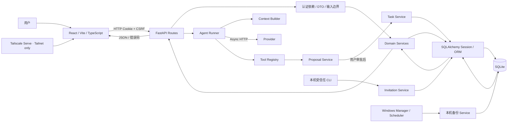

# Personal OS · Project Engineering Ledger

本文件是 Personal OS 项目级历史与工程索引。它综合 Git、本地发布清单、CHANGELOG、Alembic、当前源码、测试和阶段验收记录；不同证据源不能互相替代。

**核对快照：** 2026-10-19，分支 `develop/v0.4`，HEAD `1569b04`（tag `v0.3.3`）。本地 Git 可见两个提交。工作区包含此前开发变更及文档，`f4b5c6d7e8f9` Invitation 和 `a6c7d8e9f0a1` 注册安全状态迁移均为未提交开发内容。v0.4.0 未发布。

## 证据等级与读法

- **Git** 能确认已提交文件及提交时间；它不能还原提交前未留存的过程。
- **`release_history.json`** 是仓库声明的产品发布记录，但其中历史验证只代表其写明的范围，不能当成本轮重跑。
- **CHANGELOG、验收报告和架构文档**记录阶段事实和限制；文档所述结果仍须按原文区分用户确认、自动化结果、真实 Provider 和正式环境验收。
- **当前源码 / 测试**证明实现位置和测试覆盖，不单独证明公网部署、真实模型质量或所有用户隔离场景。
- 状态：**HISTORICAL** 表示发布/历史材料有记录；**VERIFIED** 表示有限范围有当前代码和已归档测试证据；**PARTIAL** 表示已有部分实现但功能/验收仍有限；**DESIGN ONLY** 表示仅有设计；**MISSING** 表示当前没有实现证据。

## A. 项目起源与问题变化

最初发布说明将产品定位为可在 Windows 与手机私有访问的个人任务和记录工具，先建立 Task、个人记录、登录、AI Provider/Agent 与 Tailnet HTTPS 基础。初始 Alembic 表定义包含 Task、Health Metric、Workout、Study Record/Error、Daily Review、User/Session 和 Task Evidence。表存在不代表相应 UI、验证或所有权边界当时已完整。

后续问题从“记录分散、需要个人工作区”逐步变为：持续对话难以和真实来源/任务衔接；AI 的建议必须和正式任务写入分离；历史数据需要账户管理、备份和恢复；知识需要可追溯和经用户授权；最后需要解决 Review、Proposal、Agent 和 Task 之间的业务边界及多用户安全。上述变化由 `release_history.json`、版本 CHANGELOG、迁移和测试记录支持，不推断用户未写入项目的个人动机。

## B. Git 与产品版本时间线

### 本地 Git 可核对时间线

| 日期 | Commit / Tag | 可证实内容 | 边界 |
|---|---|---|---|
| 2026-10-14 | `19780aa` · `v0.3.2` | 仓库第一条可见提交；加入 118 个文件，含当前大部分前后端、迁移、测试、服务运维、发布清单和 v0.3.2 CHANGELOG。 | 无父提交。README/版本材料回述 0.1–0.3.1，但 Git 无法证明其逐阶段代码变化。 |
| 2026-10-14 | `1569b04` · `v0.3.3` | Knowledge Intelligence 增量；增加真实浏览器审批 E2E、Knowledge 检索/上下文/关联相关代码与测试。 | 这是 `main` 与 `develop/v0.4` 当前共同 HEAD；它是本地 tag。远端 Release 是否已创建未由本轮查询验证，仓库记录为尚未完成远端发布。 |

本地可见 tags 只有 `v0.3.2` 和 `v0.3.3`，分支只有 `main` 与 `develop/v0.4`，两者当前都指向 `1569b04`。历史早期版本没有独立 Git tag/commit 可供逐提交复核。

### 发布历史（来自 `release_history.json`，不是 Git 推断）

| 产品版本 / 日期 | 业务背景与主要功能 | 技术变更 / 迁移证据 | 事故与测试证据 | 遗留问题 |
|---|---|---|---|---|
| **0.1.0 / 未记录** | 基础任务、个人记录、登录、DeepSeek Agent、Tavily 工具、Tailnet 私有 HTTPS。 | React/Vite/TS、FastAPI、SQLAlchemy、Alembic、SQLite；`693f6298b4bb` 初始表结构可见 Task/Health/Study/Review 等。 | 发布清单没有此版本测试统计；后续安全加固明确不是初版已具备的保证。 | Tailscale 依赖 Windows 主机；Notion、云运行、完整知识工作流未实现。 |
| **0.2.0 / 未记录** | 账号资料和会话管理、本机备份/自动备份、加密迁移包与隔离恢复验证、设置页整理。 | `f1a2b3c4d5e6` 标注 P1B Account/Chat；增加 display name、聊天保存偏好与 `chat_messages`。迁移包在 `backup_service.py`、`scripts/restore_migration.py`。 | 发布清单未给完整测试统计；不能据功能描述宣称跨机切换或生产恢复已验收。 | 多轮聊天工作区待 0.3；异地备份、自动新机切换待做；主题图片不在迁移包内。 |
| **0.3.0 / 2026-10-13** | 持久化多轮 Chat、会话管理/导出、Agent Run 与工具来源；Task 工作区、状态/证据/对话关联、Token 用量、主题与响应式导航。 | 使用 Conversation/Message/Task/Run/Source 关系；K1 相关视觉注释和后续 `c5d6e7f8a9b0` 迁移体现工作区与模型请求用量演进。 | 发布清单没有该版测试统计；不要将“功能发布说明”替代当前 E2E。 | Notion、结构化知识、异地备份未实现；iPhone 实机 UX 未验收。 |
| **0.3.1 / 2026-10-13** | AI Task 创建/规划/修改模式，日期时间线、Daily Settlement、Dashboard 今日/逾期/未排期分组、归档/恢复/软删除与受保护清理。 | Task Service、操作幂等、状态/日期历史增强；`a1…`、`b2…`、`c3…`、`d4…`、`e8…` 迁移反映此类结构演进。 | `release_history.json` 未给该版通过数；不能补造统计。 | 结构化知识、Notion、异地备份及当轮生产/iPhone/完整 Agent E2E 仍有边界。 |
| **0.3.2 / 2026-10-14** | Stability & Lessons：统一 Windows 管理入口、健康检查、单实例保护、非交互启停和系统信息稳定性经验。 | `personal_os_manager.ps1`、`windows_service.py`、运行标记、轮转日志；复用当前用户 `Start-Process` + `pythonw.exe`。 | `docs/postmortems/2026-10-13-background-lifecycle.md` 记录 X 关闭后 FastAPI 退出/Tailnet 502；历史终止者未知。用户确认过无控制台实验，但不能隔离 pythonw 单独因果；登录自启/重启/异常恢复未在该轮实测。 | 不是真正 Windows Service；注销、睡眠、关机、异常自动恢复不保证；旧事故根因未知。 |
| **0.3.3 / 2026-10-14** | Knowledge Intelligence：用户授权知识检索、真实来源、可编辑 Proposal，经批准由 Task Service 创建任务并关联 Knowledge。 | `KnowledgeService`、Context/Agent/Tool 更新；`f3a4b5c6d7e8` Knowledge inbox migration 已在 0.3.2 首个 Git snapshot 中；0.3.3 增量本身主要扩展既有表/服务。 | 归档结果：后端 127、Vitest 28、Playwright 1，TS/build 通过，使用隔离 SQLite/Mock Provider；不能证明付费 Provider 质量或正式库审批。 | GitHub Release 未完成；实机 UI、真实模型质量和跨设备验收未覆盖；文本检索不是向量检索。 |
| **0.4.0 / Unreleased** | Review/Knowledge Feedback、安全边界修复、邀请 CLI、后端邀请注册及 React 注册页面。 | Review Facade、Proposal/Task Service、Fail Closed、Invitation、注册安全状态表；`f4b5c6d7e8f9` 后接 `a6c7d8e9f0a1`。 | P0.4c-1 本轮实跑后端 168、前端 39、Playwright 5 passed；此前 P0.3e 142/35/2、P0.4b-1 149/35/2、P0.4b-2a 后端 167/18 是历史切片成绩，均不代表发布验收。 | 全资源生命周期与文件跨用户验证、生产 HTTPS/代理拓扑、独立安装、备份恢复、安全/许可和正式发布仍未完成。 |

**版本口径：** `release_history.json.current_version` 当前为 `0.3.3`；产品版本、Git Tag 与 Alembic revision 是不同的版本域。`0.4.0` 的 CHANGELOG 是 Unreleased，不因有 migration 或测试就成为正式版。

### 阶段标签与迁移线索

| 标签/Revision | 仓库证据 | 可以说什么 / 不能说什么 |
|---|---|---|
| Stage 1 | 精确阶段封板文档未找到；`reset_password.py` 有 `stage1-local` 默认用户名。 | 可确认有该字符串；阶段目标、完成日期和验收不能确认。 |
| Stage 3A | 当前 `README`、`docs`、CHANGELOG、Git subject 未发现可对应的封板记录。 | 阶段范围/测试未知，不按名称猜测。 |
| K1 / K1-C | `theme.css` 有 K1 可读性注释；migration `c5d6e7f8a9b0_k1c_tasks_and_model_usage.py` 明确增加 Task 对话关联和模型用量。 | K1-C 的数据库变化可证；它何时开始、完整 K1 阶段范围与单独测试成绩未由 Git 历史证明。 |
| K2-B / K2-C | CHANGELOG 记 K2-B Knowledge 收集箱、七领域、CRUD 与 `f3a4b5c6d7e8`；Knowledge 契约记 0.3.3 K2-C 检索/授权上下文/确认任务链路。 | 这些文档和测试可核对；不能把 K2-D 预留写成自动 Review 提炼已实现。 |
| P1B | `f1a2b3c4d5e6_p1b_account_and_chat.py` 增加 User 偏好字段与 Chat message 表；0.2 release description 记账号/聊天/备份方向。 | migration schema 可证；阶段精确日期和 P1B 独立验收报告未找到。 |

**Alembic revision 顺序**（文件 `down_revision`，不是产品版本排序）：`0001_initial → 693f6298b4bb → 8f3d7c0a1b2c → c4e5f6a7b8c9 → d5e6f7a8b9c0 → e7f8a9b0c1d2 → f1a2b3c4d5e6 → a2b3c4d5e6f7 → b3c4d5e6f7a8 → c4d5e6f7a8b9 → c5d6e7f8a9b0 → f2a3b4c5d6e7 → a1b2c3d4e5f6 → b2c3d4e5f6a7 → c3d4e5f6a7b8 → d4e5f6a7b8c9 → e8f9a0b1c2d3 → f3a4b5c6d7e8 → f4b5c6d7e8f9 → a6c7d8e9f0a1`。

迁移主题包括：初始表、Provider、用户 ownership、Agent runtime、搜索 Provider、账户/聊天、任务/提案生命周期、聊天工作区、Task/Agent 用量、任务操作模式、清理回执、Knowledge inbox 和 Invitation。`f4b5…` 当前处于未提交开发状态；不能声称已发布给所有安装实例。

## C. 功能总账

状态描述当前代码与已有验收的范围，不等同于本轮重跑或生产证明。

| 功能 | 当前状态 | 源码 / 证据 | 范围与限制 |
|---|---|---|---|
| Task | **VERIFIED** | `services/task_manager.py`、`routes.py::create_task`、`TasksWorkspace.tsx`；`test_k2a1_task_manager.py`、Task E2E | 统一 Task 数据；手动路由和 AI Proposal 共用 Task Service 核心持久化。历史手动同名允许重复，AI 有其自身去重规则。 |
| Health | **PARTIAL** | `models/entities.py::HealthMetric/Workout`、`context_builder.py` 敏感域排除、初始迁移 | 数据模型/历史记录存在；没有证据证明早期完整健康工作流在当前多用户/AI 访问路径下全量验收。通用 Agent context 明确不含 Health/Finance。 |
| Learning | **PARTIAL** | `StudyRecord/StudyError`、`context_builder.py::study_feedback`、`main.tsx` 模块路由 | 学习记录和反馈模型/上下文存在；外部课程、独立学习效果评估和全流程验收无证据。 |
| Dashboard | **VERIFIED（有限）** | `main.tsx`、`task_manager.dashboard_task_rows`、`release_history` 0.3.1 | 当前任务状态摘要；不代表目标达成或能力增长指标已实现。 |
| Review | **VERIFIED（隔离路径）** | `DailyReviewWorkspace.tsx`、`review_service.py`、`task_manager.py::task_summaries`；Review pytest/Playwright 归档 | 每日记录、周汇总、Task Summary Facade、异步竞态保护；自报进度不自动成为正式 TaskEvidence。无独立结果核验/因果评价。 |
| Knowledge | **VERIFIED（0.3.3 隔离闭环）** | `knowledge_service.py`、`knowledge_routes.py`、`KnowledgeWorkspace.tsx`；Knowledge E2E/契约 | CRUD、词项检索、来源关联、用户授权、Proposal 转任务；不是向量检索，Mock 不能证明真实 Provider 质量。 |
| Chat | **VERIFIED（隔离范围）** | `ChatWorkspace.tsx`、`routes.py`、`ChatConversation/Message`；Chat tests 与 0.3.3 E2E | 持久化会话、历史和管理；设备 UX/公网上线另行验证。 |
| Agent | **PARTIAL** | `agent_runner.py`、`context_builder.py`、`tool_registry.py`、`agent_audit.py` | Async Provider 请求、上下文限制、工具和运行记录存在；测试使用 Mock，真实付费 Provider 回答质量/成本未证明。 |
| Proposal / Approval | **VERIFIED（隔离写入路径）** | `proposal_service.py::apply_proposal_action`、`AgentProposal`、`Task Service`；并发/rollback/Playwright 测试 | 用户批准后才正式创建 Task；事务和幂等已有测试。不是所有失败、跨账户和生产部署组合均覆盖。 |
| Provider | **PARTIAL** | `provider_service.py`、`settings/ai/providers` routes、`.env.example` | 用户凭证加密/状态管理与连接测试入口存在；密钥轮换、真实 Provider 质量/限额和公开部署审计尚未完成。 |
| Account | **PARTIAL（后端与 Task 浏览器闭环）** | `auth/security.py`、`api/deps.py`、`registration_service.py`、`routes.py`、`frontend/src/main.tsx`、`User/SessionToken` | 注册界面、Challenge/CSRF、服务端 Session 确认、登录/退出及 Task 双用户隔离已在临时浏览器环境验证；Knowledge/Review/Chat 等全资源矩阵、真实代理与生产 HTTPS 配置仍未验证。 |
| Invitation | **PARTIAL（注册与 Task E2E）** | `Invitation`、`AuthSecurityState` ORM、`invitation_service.py`、`registration_service.py`、CLI、Alembic `f4b5…`/`a6c7…`；`test_registration_workflow.py`、`frontend/e2e/registration.spec.ts` | 一次领取、后端注册、前端注册、错误/重试反馈和 Task 双用户隔离通过本轮隔离测试；不代表所有资源授权、代理限流或公网发布已验收。 |
| Backup / Restore | **PARTIAL** | `backup_service.py`、`scripts/backup_database.py`、`scripts/restore_migration.py`、设置页 | 本机备份、加密迁移与隔离验证流程存在；普通 Web 实例级备份/整库导出默认拒绝；正式备份恢复演练与异地备份未完成。 |
| Engineering Journal | **VERIFIED（静态内容）** | `EngineeringJournal.tsx` 与 Vitest/E2E 归档 | 可展开显示 P0/P0.4 阶段工程说明；历史文字依赖维护者证据，不是实时功能状态 API，也不是发布记录。 |

## D. 当前架构与调用链



**普通请求：** React 通过 Fetch/API Client 发 HTTP；FastAPI 路由校验 Cookie Session、对写操作检查 CSRF、解析 DTO 和认证身份；Service 执行业务与 owner 校验；SQLAlchemy 同步 Session 提交或回滚；FastAPI 序列化响应回传 UI。主要路由是同步 `def`，数据库操作使用同步 SQLAlchemy。

**Agent 调用：** API 将当前服务端 `user_id`、用户授权选项和上下文交给 Agent Runner。Runner 用异步 HTTP 客户端等待 Provider 响应；工具名和参数由 Tool Registry 白名单校验，并核对 Run/User 归属。Tool 可以读取受限上下文、创建 Proposal，或在明确授权的任务管理路径调用 Task Service。Provider 文本本身不是数据库事实，成功写入以 Service/事务结果为准。

**事务：** 数据库事务只覆盖被纳入同一 Session/事务的写入。Proposal 审批将状态认领、Task/状态历史/来源、Proposal 状态与审计保持一致；失败回滚。注册限流与 challenge 在独立短事务先提交；随后邀请领取、User、Session 在一个注册事务内提交，失败整体回滚。Cookie 仅在注册事务提交成功后设置。响应丢失后可使用凭证登录，已用邀请不可重复消费。

**后台运维：** FastAPI lifespan 启动定时检查并通过 `asyncio.to_thread` 执行本机备份；Windows Manager 管理服务生命周期；Alembic 迁移是单独运维步骤，不在应用启动时静默改 schema。Tailscale Serve 提供 Tailnet 私有 HTTPS，不代表公网托管。

## E. 七大工程机制

| 机制 | 解决的问题 / 当前实现 | 代码入口 | 归档测试与边界 |
|---|---|---|---|
| **ID** | 分清 User、Proposal、Operation、Task、Invitation record 和邀请码 Token。 | `entities.py`：`User`、`AgentProposal`、`TaskManagerOperation`、`Task`、`Invitation` | `test_k2a1_task_manager.py` 的幂等/跨 Proposal 操作键测试；`test_invitation_service.py`。Invitation ID 不可作注册令牌，未来注册 Operation ID 尚未实现。 |
| **State Machine** | 只允许有定义的状态转换；Proposal `PENDING → APPROVING → APPROVED` 与 Task `TODO` 是不同对象/事实。 | `proposal_service.py::apply_proposal_action`、`TaskStatus`、`invitation_service.py::get_invitation_state` | 重复/并发批准和邀请重复领取测试；不覆盖所有并发数据库部署。 |
| **Service** | 把业务规则、资源归属和写入权放在业务边界，避免 Route/别的模块自行写 ORM。 | `task_manager.py`、`knowledge_service.py`、`review_service.py`、`proposal_service.py`、`invitation_service.py` | 手动 Task 委托、TaskSummary Facade、Knowledge/Review workflow tests；不能声称每个模块已完全消除 ORM 耦合。 |
| **Transaction** | 相关写入一同提交或回滚，避免半完成 Proposal/Task。 | Proposal Service / Task Service 共用 `Session`；Invitation Service caller-owned transaction | Proposal 来源归属失败 rollback、Invitation rollback tests；真实故障恢复与多实例事务未验收。 |
| **Idempotency** | 同一个重试操作不重复产生业务副作用；请求语义不同则冲突。 | `TaskManagerOperation`，唯一键 `(user_id, client_operation_id)`；手动 UUID `Idempotency-Key` | 重复批准、并发批准、相同/不同请求键测试；手动请求无 Header 时仍允许新建重复同名任务。邀请一次性领取不是注册请求幂等。 |
| **Authorization** | 身份取自服务端 Session，并按用户资源归属授权；实例级 Web 能力无 Admin 模型时拒绝。 | `api/deps.py`、Routes、Service owner queries、`tool_registry.py::_assert_run_owner` | 跨用户 Review/Knowledge/Run、备份 fail-closed tests；全资源双用户注册测试仍是发布阻断。 |
| **Audit Trail** | 保留谁通过何种正式操作改变了业务状态及其来源。 | `TaskStatusHistory`、`TaskManagerOperation`、`AgentAuditEvent`、`AgentToolCall`、Proposal 和 Invitation timestamps | Proposal/ToolCall/Task tests；审计不证明外部现实结果，也应避免保存凭证或敏感正文。 |

更完整的 Task 写入和面试例子见 [Task Lifecycle](task-lifecycle-engineering.md)；业务输入输出见 [Task module contract](task-module-contract.md)。

## F. 事故与改进记录

| 事故 | 根因 | 修复 | 回归证据 | 可复刻经验 |
|---|---|---|---|---|
| Windows 后台进程在窗口关闭后退出，Tailnet 502 | 早期关窗实验与正式用户操作不同；历史终止者未知；曾有过早归因和过度扩架构路线。 | v0.3.2 复用用户确认的 Start-Process + `pythonw.exe` + 原入口；健康/单实例/精确停止；保留事故未知结论。 | `docs/postmortems/2026-10-13-background-lifecycle.md`；用户确认与自动化模拟分开记录。登录自启/重启仍未验收。 | 单变量最小实验；测试通过不等于部署通过；不能猜终止者。 |
| Task ORM 多处写入 | 手动 `POST /api/tasks` 曾在 Route 直接创建 ORM，AI 路径走 Task Service。 | P0.3e 将手动写入委托 `create_manual_task`，Proposal 经 Task Service。 | `test_manual_task_api_delegates_persistence_to_task_service`、并发批准及 rollback tests；P0.3e 归档 142/35/2。 | 先用失败测试锁定旧路径，再收敛唯一写入入口；兼容旧语义须单独保留。 |
| Review 与 Task ORM 耦合 | Review 聚合直接依赖 Task 数据结构/查询细节。 | Task Service 暴露批量 TaskSummary DTO；Review 只读摘要与归属校验。 | `test_task_summary_facade_batches_and_omits_foreign_or_missing_tasks`、Review workflow tests。 | 跨模块用最小 DTO/Facade，而非暴露 ORM/Session。 |
| 过期 Review GET 覆盖输入 | 日期/刷新请求乱序返回，且编辑字段没有保护。 | 读取序号、日期/卸载检查、dirty-field 保留与保存期间请求约束。 | `DailyReviewWorkspace.test.tsx` 可控 Promise 顺序；Review E2E 延迟/刷新场景（依阶段记录）。 | 按当前视图身份校验异步响应；不以固定延迟或移除 StrictMode 掩盖竞态。 |
| Agent Run/User 归属不匹配 | 工具调用不能只信任入参 user_id 或内存 Run 对象。 | `tool_registry.py::_assert_run_owner` 同时校验可信身份和数据库 Run owner，工具副作用前拒绝。 | `test_tool_registry_rejects_mismatched_run_and_user_before_read_or_audit`。 | 在工具/数据边界验证上下文身份和持久化身份一致。 |
| 实例级 Web 备份授权缺失 | 普通登录 Session 没有可信 Admin 角色，但可到达全库备份/导出入口。 | 未建立 Admin 前对实例级 Web routes fail closed；Web UI 显示不可用；本机 CLI/既有后台运维路径独立。 | `test_instance_backup_web_routes_are_denied_before_side_effects`；前端 403 测试。 | 登录身份不等于实例运维身份；先授权再执行任何副作用。 |
| Proposal 审批重复/事务不一致 | 并发 SELECT 后写可能双重批准，Proposal 与 Task 分开提交会半完成。 | 条件状态更新、同一事务 Task/来源/历史/Proposal/audit、确定性操作 ID 和唯一约束。 | `test_concurrent_approval_of_same_proposal_creates_one_task`、`test_proposal_approval_rolls_back_task_when_source_is_not_owned`。 | 状态锁/条件写、数据库约束和事务各自处理不同失败面。 |
| Invitation 并发领取/迁移失败 | 先 SELECT 再 Python 判断有并发窗口；新表必须同时有可升级路径。 | SHA-256 摘要唯一；条件 UPDATE 原子领取；migration `f4b5…`；Service 留给上层事务。 | `test_invitation_service.py` 记录并发、重复、rollback、空库/旧 schema/冲突场景；149 后端为 P0.4b-1 报告成绩，不是本轮重跑。 | 迁移、ORM、状态更新和调用方事务共同定义安全契约；成功领取不等于注册已实现。 |

## G. 从零复刻的施工顺序

| 顺序 | 阶段与对应项目入口 | 最小完成标准 | 失败回退 |
|---|---|---|---|
| 1 | 环境/依赖：`backend/pyproject.toml`、`uv.lock`、`frontend/package.json`、`pnpm-lock.yaml`、`.env.example` | 锁定依赖可复现安装；配置示例无秘密；服务 loopback 启动健康。 | 停止服务；撤回本次环境变量/安装目录变更，不碰真实数据。 |
| 2 | ORM/迁移：`models/entities.py`、`database.py`、`alembic/` | 空临时库从 base 升到 head；旧 schema 副本前滚；FK/integrity 检查。 | 保留原库；失败只对副本诊断，应用代码回退优先于 destructive downgrade。 |
| 3 | FastAPI/认证：`api/routes.py`、`api/deps.py`、`auth/security.py` | Session、CSRF、401/403/404 契约；owner 身份仅来自服务端。 | 禁止开放外网；恢复只使用未迁移副本和上一应用版本。 |
| 4 | Service：`task_manager.py`、`knowledge_service.py` 等 | DTO/Service 管规则；边界错误、事务和双用户测试通过；跨模块不写 ORM。 | 回退单一 Service 改动，保留 schema/数据；修复只影响隔离库。 |
| 5 | React：`main.tsx`、Workspace 组件、API Client | 加载/错误/空状态/保存/刷新/键盘访问；失败请求不显示假成功。 | 逐组件回退，不动 API/数据库。 |
| 6 | Agent：`agent_runner.py`、`context_builder.py`、`tool_registry.py` | Mock Provider 验证可用工具、上下文最小化、用户身份继承和失败无副作用。 | 默认禁用写工具/外网工具；不调用付费 Provider。 |
| 7 | Proposal/Approval：`proposal_service.py` | PENDING 草案与正式 Task 区分；审批/拒绝/幂等/并发/rollback 均测。 | 关闭批准入口/保留 PENDING，回滚隔离测试事务；不伪造已创建任务。 |
| 8 | 安全：认证/owner/CSRF/备份/密钥/限流 | 双用户读取写入和关联 ID 全覆盖；实例级无授权则拒绝；日志脱敏。 | fail closed、撤销 Session/入口；不拷贝用户数据做修复。 |
| 9 | 测试：pytest/Vitest/tsc/Vite/Playwright | 全部指向临时 DB/目录与 Mock；记录命令、退出码、覆盖边界。 | 停止并保留失败证据；绝不清理正式 DB/他人测试目录。 |
| 10 | 部署：Windows Manager + Tailscale | 新机器配置、启动/健康/停止、迁移/备份恢复逐项实测；Tailnet only。 | 保留旧库和旧配置副本，经核验后人工切回；不自动删备份。 |
| 11 | 发布：CHANGELOG、release_history、tag/远端 | 负责人验收、许可证/隐私/密钥审查、版本事实更新、构建可复现。 | 未过门槛维持 Unreleased；不先打正式 Tag 或对外发布。 |

## H. 面试表达与个人贡献边界

本项目的真实分工应表述为：**负责人定义产品目标、批准范围并验收切片；AI Coding Agent 在授权范围内协助源码分析、实现候选、编写/运行测试和归档；提交历史和测试报告用来区分代码来源、阶段报告与独立复测。**不应声称独立手写全部代码，也不应把 Mock Provider、用户确认或历史测试结果说成当前亲自执行的生产验收。

### 90 秒中文版本

Personal OS 从 Windows 本地个人任务和记录工具演进到 AI 辅助的知识、任务与复盘工作区。早期版本建立 React、FastAPI、SQLAlchemy、SQLite 和 Tailscale 私有访问；之后增加账号、会话、备份，再发展出 Agent Run、工具调用、Task Service、Proposal 审批和可追溯 Knowledge。我的工程关注点是让 AI 建议与正式业务写入分开：Proposal 先保持 PENDING，用户批准后才通过 Task Service 创建 TODO Task，并在事务中记录来源、状态历史和操作；操作键与数据库约束负责重试防重。开发中也处理了 Review/Task ORM 耦合、异步响应覆盖输入、Run/User 身份不一致和无管理员时的 Web 整库备份授权问题。负责人定义目标和验收标准，AI Coding Agent 协助在批准切片内分析和实现；我会按实际测试证据报告边界。当前 v0.4.0 是源码发布候选，v0.3.3 历史发布记录保留；邀请码注册、核心 API 双用户隔离和同机合成安装/恢复已有隔离证据，但 Windows 正式 ACL、正式 8000 服务升级、全新主机和公开 GitHub Release 仍未验收或执行。

### 3 分钟技术讲述提纲

1. **背景与演进：** v0.1 的个人 Task/Health/Study/记录基础，v0.2 账号和备份，v0.3 持久化 Chat/Agent/Task 时间线，v0.3.3 Knowledge→Proposal→Task 的经授权闭环；说明更早阶段没有 Git commit 证据。
2. **架构：** React 通过 HTTP/CSRF 到 FastAPI；服务端 Session 提供 user_id；Service 访问 SQLAlchemy/SQLite；Agent Runner 异步请求 Provider，Tool Registry 限制工具，Proposal 审批后进入 Task Service。
3. **机制：** DTO/Facade 降低跨模块耦合；状态机分离 PENDING/TODO；事务回滚；数据库唯一键与条件 UPDATE 处理幂等/并发；审计保留操作过程。
4. **故障：** 手动 Task 曾绕过 Service；Review 曾直接看 Task ORM；过期 GET 可覆盖编辑；Run/User 不一致；实例级备份无 Admin 契约；Proposal 并发/事务；邀请 token 重复领取窗口。每项都指出测试，而不是只说“修好了”。
5. **证据和局限：** 明确 127/28/1 是 v0.3.3 归档，142/35/2 与 149/35/2 是不同 v0.4 切片报告；Mock 不证明真实 Provider；注册/安全/部署门槛仍待验收。

### English short version

Personal OS evolved from a private task and personal-record workspace into an AI-assisted knowledge, task, and review system. The application uses React, FastAPI, SQLAlchemy, and SQLite. Agent calls go through a server-owned run context and a restricted tool registry. AI task proposals remain pending until a user approves them; approved writes go through the Task Service with transaction and idempotency controls. During v0.4 development, the work addressed cross-module ORM coupling, stale Review requests, Run/User ownership checks, fail-closed instance backup routes, and atomic invitation claims. The project owner defined scope and acceptance, while an AI coding agent assisted with implementation and tests. v0.4.0 remains unreleased; invited web registration, core two-user API isolation, and synthetic same-host installation have isolated test evidence. Production TLS, full resource lifecycle, startup schema checks, and cross-machine recovery remain open.

## I. v0.4.0 发布差距与建议

| 缺口 | 当前状态 | 发布前最低门槛 |
|---|---|---|
| 注册 API | **PARTIAL（注册与 Task 浏览器闭环已验证）** | `POST /api/auth/register` 和 React 邀请表单已通过临时 SQLite 注册、Session 确认、退出/登录及 Task 双用户 E2E；仍需全资源授权、安全部署与发布验收。 |
| 注册 Session / 匿名防护 | **PARTIAL（后端与本地浏览器路径已验证）** | Session 可加入外层事务；HMAC 摘要限流与一次性 Challenge 位于 SQLite。本轮覆盖本地 Origin/CSRF、Cookie 属性、失效 Challenge/限流反馈；生产 HTTPS Cookie 与真实 Tailscale/反向代理地址识别 NOT VERIFIED，且不信任未经验证的 XFF。 |
| 双用户资源隔离 | **PARTIAL** | A/B 对 Task/Evidence/Knowledge/来源/Chat/Review/Proposal/Run/ToolCall/文件/Provider/检索上下文及跨用户 ID 的读写测试，检查副作用为零。 |
| 全新安装/环境配置 | **PARTIAL（同机隔离目录已验证）** | 锁定依赖、模板对应环境变量、空库迁移、合成账号/邀请、React 注册与重启读回通过；独立机器/操作系统未测。 |
| v0.3.3 升级兼容 | **PARTIAL（合成旧库已验证）** | Tag 对应迁移链到 f3；合成 User/Session/Task/Knowledge/Review/Proposal 升到 Head 且重复升级无重复数据；真实个人库未测。 |
| 备份恢复 | **PARTIAL（合成库已验证）** | SQLite CLI 快照/恢复与加密包 Service 验证/恢复通过；普通快照保留 Session、加密恢复撤销 Session；本机加密导出 CLI 和实际切换未验收。 |
| Provider Key/成本/无 Key 行为 | **PARTIAL** | 无 Key 降级、Key 不出 API/日志、真实调用需用户授权、限额/成本显示和失败处理测试。 |
| 许可证/公开安全审查 | **MISSING / NOT VERIFIED** | 当前 Git tracked 文件清单未发现 LICENSE；先确认许可证选择，再扫公开历史/工作区密钥、个人数据、数据库、备份和日志；这是审查待办，不在本轮做法律结论。 |
| GitHub 发布 | **NOT VERIFIED** | 当前本地 origin 指向 GitHub；本轮未访问远端；仓库记录称 v0.3.3 未完成远端 Release。v0.4 只有全部门槛通过并批准后才发布。 |
| R0 六大决策领域 | **DESIGN ONLY** | Goal/Constraint、World Model、Decision Engine、Action Orchestrator、Feedback、External Intelligence 不属于 v0.4 发布功能。 |

**建议顺序：** P0.4b-2a/2b 注册与 Task 浏览器链、P0.4c-1 核心资源 API 隔离、P0.4c-2 同机独立安装/合成升级/恢复已有隔离证据。下一切片验收真实 HTTPS/Tailscale、Session、文件和 Provider 边界，补可信本机迁移包导出方案，再做许可证、公开历史与正式发布复核。每个阶段单独验收。

## 文档索引与职责

- [项目入口 README](../../README.md)：精简说明定位、Quick Start、状态、测试与文档入口。
- [CHANGELOG](../../CHANGELOG.md)：版本变更、Unreleased 和发布事实边界。
- [Task Lifecycle](task-lifecycle-engineering.md)：Task / Proposal 的深入机制、故障与面试材料。
- [Task 模块契约](task-module-contract.md)：Task API/Service 边界。
- [Knowledge 模块契约](knowledge-module-contract.md)：知识检索、来源与批准转换。
- [Review 模块契约](review-module-contract.md)：每日/每周 Review 行为与 Facade。
- [账户邀请与授权设计](account-invitation-and-authorization-design.md)：P0.4b 设计、CLI 和待注册契约。
- [AS-IS 审计](personal-os-as-is-audit.md)、[长期产品宪章](personal-os-charter.md)、[目标契约](personal-os-target-contracts.md)、[R0 路线](personal-os-r0-roadmap-and-acceptance.md)：当前边界与未来设计。
- [Windows 服务运维](../operations/service-lifecycle.md)、[生命周期事故复盘](../postmortems/2026-10-13-background-lifecycle.md)：运行与事故证据。

## P0.4c-1 多用户隔离审计增量

本轮工作区审计确认：API 身份来自服务端 Session；业务资源的核心查询普遍按 `user_id` 过滤，跨用户对象 ID 多采用 404；Web 实例级备份/全库导出保持 403 fail-closed。此结论仅限列出的测试与代码入口，不是整套部署安全认证。

新增 `backend/tests/test_mult_user_isolation.py` 以两个合成用户扩展 API 隔离回归：Task/Evidence、Knowledge 检索与 Task 关联、Conversation/Message 关联、Proposal 审批、Agent Run/ToolCall、Daily/Weekly Review、Study/Health 列表、Provider 凭证 response，以及备份/导出。拒绝之后通过独立 Session 读回 Task、Evidence、KnowledgeTaskLink、TaskConversationLink、Proposal 和 Review，确认没有相应跨账户写入副作用。

**本轮实跑证据：** 后端全量 pytest 168 passed；前端 Vitest 39 passed；`tsc -b` 退出码 0；临时 Vite build 退出码 0（保留 chunk-size 警告）；隔离 Playwright 全量 5 passed；新增双用户 API 定向测试 1 passed。Playwright 现有双用户闭环只直接验证 Task，不能写成全资源 E2E。新测试只覆盖核心 API，不涵盖每一个 restore/export/purge 状态组合。

| 领域 | P0.4c-1 状态 | 证据/边界 |
|---|---|---|
| Task、Evidence、状态与关系 | **VERIFIED（核心读写）** | 新双用户 API 测试与既有 Task Service/状态历史测试；未逐一双用户测试所有清理状态。 |
| Knowledge、检索、来源、Task link | **VERIFIED（核心 owner 与关联）/ PARTIAL（全生命周期）** | 新测试：私有正文不进 B 的检索结果，跨用户 card/task link 404 且关系表无新增；知识源导入/导出的所有分支未全测。 |
| Chat、Conversation、Message | **VERIFIED（核心访问/关联拒绝）/ PARTIAL（全生命周期）** | 新测试拒绝读取/修改/删除 A 会话及跨账户 Task/Message association；已有 Chat tests 验证存储和可见性。 |
| Proposal、Approval、Task 持久化 | **VERIFIED（跨用户拒绝与无副作用）** | 新测试后 Proposal 仍 PENDING，B 无 Proposal；原有并发审批/原子事务测试。 |
| Agent Run、ToolCall、Context | **VERIFIED（关键身份检查）/ PARTIAL（生产 Provider）** | 新测试 Run ToolCall API 404；已有 Run/User mismatch 与 Context exclusion tests；无真实 Provider 测试。 |
| Review、Learning、Health | **VERIFIED（核心列表、复盘和关联）/ PARTIAL（全 CRUD）** | 新测试按用户空列表、Review 读隔离及外人 Task 快照拒绝；Workout/Metric 无全端点隔离 E2E。 |
| Provider 密钥 | **PARTIAL** | 单用户配置按 owner、返回不含密钥；新测试只证实 A 的合成密文凭证不出现在 B response。共享环境变量 key 是否可被每个已登录用户调用及成本边界未验证。 |
| 主题图片/上传路径 | **PARTIAL / NOT VERIFIED（跨账户运行验证）** | 代码按 user_id 分目录、校验 safe filename 和解析后的父目录；无本轮双用户文件读写 E2E，Windows ACL/符号链接威胁未核验。 |
| Account/Session/Invitation | **PARTIAL** | 注册与邀请码原子性有历史专项测试；停用账户、Session 交叉撤销、CLI OS ACL 未在本轮验证。 |
| Web Backup/Export | **VERIFIED（当前 Web 入口 fail-closed）** | 旧备份副作用测试加本轮双用户请求；本机恢复不属于 Web 权限测试，需 P0.4c-2。 |

没有发现由本轮新增测试证明的生产代码越权漏洞，故未改业务逻辑或数据库。新增文件只为隔离回归测试。通过范围支持继续做 P0.4c-2 的代理 HTTPS、独立安装与备份恢复演练；仍不足以宣称 v0.4.0 发布就绪。详细路由/服务/测试入口和剩余风险见[权限验收契约](account-invitation-and-authorization-design.md#p04c-1-全资源多用户隔离验收记录)。

## P0.4c-2 独立安装、升级与恢复验收

**范围与证据：** 在 `%TEMP%/PersonalOS-P04c2-09fe03ee92a84acf98a2475799872875` 白名单复制后端源码/迁移/测试、前端源码/静态资源、两个锁文件和公开 `release_history.json`；没有复制 `.env`、`data`、备份、私人日志或已有虚拟环境。安装用 Python 3.14.6、uv 0.11.31、Node 24.19.0、pnpm 11.25.0；锁内后端 FastAPI 0.143.0、SQLAlchemy 2.1.4、Alembic 1.20.0，前端 React 19.3.0、Vite 8.3.4。`uv sync --locked` 首次因本地包版本在 `uv.lock` 仍是 0.3.2 而退出 1；校正该单行到 `pyproject.toml` 的 0.3.3 后退出 0，`pnpm install --frozen-lockfile` 退出 0。首次副本类型检查因未纳入公开 `release_history.json` 退出 1，补齐白名单后退出 0；本项是复制范围问题，不是源码缺陷。

**空库与真实请求：** 使用副本内专用 `alembic.isolated.ini` 将目标明确设为独立 SQLite，`upgrade head` 到 `a6c7d8e9f0a1`；建立合成首账号，本机 `scripts.manage_invites create` 在交互终端一次显示合成邀请码并经 Challenge/注册 API 消费。副本 FastAPI 在 `127.0.0.1:8166` 服务已构建的 React，健康与首页分别返回 200；副本 Playwright 注册专项 2 passed，覆盖 UI 注册、任务保存/刷新、退出、再登录及双用户任务拒绝。停服后重启同一副本，重新登录可读回同一任务。此演练复用本机包缓存与已安装 Chrome，未证明一台全新 Windows 机器的安装。

**旧库：** `v0.3.3` Tag 的迁移版本集止于 `f3a4b5c6d7e8`，旧 revision 文件与当前工作树内容未见改动。由该迁移链建立合成旧库，每表写入 User、Session、Task、KnowledgeCard、DailyReview、AgentProposal 一条；升级 Head 两次后六表均保持 1 条，Invitation 和 `auth_security_state` 表建立，`integrity_check=ok`、`foreign_key_check=0`。真实旧库、包含媒体的迁移、故障后自动切换没有执行。

**备份/恢复：** `app/scripts/backup_database.py` 对合成当前库生成 SQLite 快照并恢复到另一个新目录：User 4、Session 4、Task 2、状态历史 2、Knowledge 1、关系 1、Review 1、Proposal 1、审批审计 2、Invitation 4 等记录、ID 与关系完全一致，完整性和外键检查通过；已有目标覆盖被拒绝。普通快照是未加密数据库，保留 Session 与密码哈希、Provider 密文，不包含外置主密钥；应受 OS 权限保护，跨实例直接启用前必须先处理 Session 与密钥。另用合成 Provider 凭证和临时目录调用 `backup_service.export_migration_package`、验证、恢复到新目标：包内密钥/凭证位于密码加密容器中，恢复后 Session 数为 0，原 Task/Proposal/Knowledge/Review/Invitation 保留；恢复库在 `127.0.0.1:8167` 启动、登录、任务读写成功。损坏包拒绝且不产生目标文件，已有目标拒绝覆盖且内容哈希未变。**限制：** Web 全库导出按既有安全规则拒绝；当前只有加密包恢复 CLI，没有受信任的本机加密包导出 CLI，因此跨机器可操作的端到端交付流程仍不完整；上传主题图片不在迁移包内。

**工程概念与回退：** Git 记录代码版本，不保存业务数据的可恢复快照；Alembic 只改变 schema，不是数据库备份；SQLite Backup 固定某一时间点的库状态，Restore 后还须做 `integrity_check`、外键、核心 ID/关联和应用读回。事务 `rollback` 撤销尚未提交的同一事务；回退软件版本与恢复数据库快照分别处理，不能将旧代码指向已升级且不兼容的新 schema。升级失败时停止新版本启动，保留原库和新路径备份，先在隔离副本分析迁移失败，再决定经负责人批准的恢复方案；不对正式库执行 downgrade。

**回归：** 新增当前 Head 本机备份拒绝回归先失败后通过；后端全量 169 passed，前端 Vitest 39 passed，`tsc -b` 和独立 Vite build 均退出 0，Playwright 全量 5 passed（隔离临时库/Mock Provider）。本轮未调用真实 Provider、未验证真实 HTTPS/Tailscale 或公网部署。

**发布阻断：迁移失败后仍可启动。** 另建合成旧库停在 `f3a4b5c6d7e8`，注入冲突表使 `upgrade head` 退出 1；用该库以 production 配置启动隔离端口 `8168`，`GET /api/health` 仍返回 200，而 `alembic_version` 仍为 f3。`main.py::validate_runtime_security` 只检查 Secret/Cookie，`database.py::validate_database_target` 只确认生产 SQLite 文件存在；健康查询仅 `SELECT 1`。这不满足“迁移失败时新版本拒绝启动”的发布门槛。建议单独批准生产启动时对照预期 Alembic Head 的只读校验，旧/缺失/多头 revision 一律拒绝，检查须在调度器启动前完成；用迁移失败合成库做先失败后通过测试。因这是正式启动契约变更，本切片只定位并保留合成证据，未修改生产启动行为。

## P0.4c-2a Schema 启动门禁修复

**事故到修复：** 上节记录的是 P0.4c-2 当时的真实故障与验收边界。新代码在 `app/main.py::lifespan` 通过 Secret/Cookie 检查后、创建自动备份调度任务前，调用 `app/schema_startup.py::validate_schema_revision`。后者从仓库 Alembic 脚本确定唯一 Head，以 SQLite `mode=ro` 和 `PRAGMA query_only` 读取配置库 `alembic_version` 的至多两行，要求恰好一行且等于 Head。缺文件、缺表、旧/未知版本、不可读库、数据库多 revision 或脚本多 Head 均抛出非敏感错误，中止 Lifespan；不会执行 `create_all`、自动升级或启动业务调度器。单一 revision 只是最低门槛，不保证每张业务表、字段、外部文件和 Provider 状态健康。

**验证与回退：** `tests/test_schema_startup_guard.py` 在临时合成 SQLite 上将真实 Lifespan 设置为 production，先观察旧版/缺失/未知/故障库 7 项失败，再验证当前 Head、旧库拒绝、迁移失败拒绝、升级成功后恢复、脚本多 Head、无调度器副作用及重复只读检查。旧生产配置 API 测试改用先迁移的独立临时库；浏览器脚本明确隔离测试 Cookie 属性。最终后端定向 `23 passed`、全量 `179 passed`，前端 `39 passed`、TypeScript/临时构建退出码 0、Playwright `5 passed`。测试通过只证明这条生产启动路径在合成环境中的行为；未启动正式 Windows/Tailscale 服务。部署前仍须明确目标路径、保留可恢复备份、先执行 Alembic 升级。失败时停用新代码并在隔离副本定位；不可用旧代码强行接入已升级的不兼容数据库，也不对正式库做自动 downgrade。

**概念：** Migration 是运维显式更改 schema 的动作；Startup Contract 在开始处理请求和后台任务前核验版本；Liveness 是进程存活，Readiness 是能否承接请求。当前 `/api/health` 只是已启动实例的基础 `SELECT 1`，没有独立 readiness 探针；生产门禁通过拒绝不兼容版本启动，避免旧库返回误导性 200。

## P0.4c-3 最终安全边界审计

**Session：VERIFIED（合成 API）**。Session Token 仅 SHA-256 摘要入库，14 天过期；`current_user` 与 `require_csrf` 每个受保护请求都检查 Session、时间和 User.is_active。logout 删除当前 Session 后重放旧 Cookie 返回 401；停用用户旧 Session、到期 Session 和新登录被拒；错误密码不会创建 Session。密码变更默认撤销其他 Session 的既有测试通过。Cookie Session 为 HttpOnly、SameSite=Lax；production 启动强制 Secure 配置，TLS/Tailscale 测试分支设置 Secure。新测试仅模拟应用请求，非真实浏览器 HTTPS 代理链。

**文件：VERIFIED（应用层双用户）；FAILED（OS 账户隔离）**。主题背景上传只使用可信 Session user_id，随机文件名、不接受 URL user id、private no-store/nosniff/sandbox，并限制 5 MB、24 MP、PNG/JPEG/WebP 内容。已有双用户测试验证 A 上传、B 读 404、B 删除自身设置不影响 A 文件。本轮新增 NTFS junction 路径重定向回归，修复前在用户目录 junction 下未拒绝；修复后 `user_background_dir` 对 `data/private`、主题 root 和用户目录逐层拒绝解析路径改变。私人路径没有作为 StaticFiles 映射。未读取任何正式图片内容。

**Windows ACL 发现：P0 发布阻断，未修改。** 只读 ACL 元数据检查显示 `<APP_DATA_DIR>`、`private`、`theme-backgrounds` ACL 均继承：Authenticated Users 拥有 Modify，Builtin Users 拥有 Read/Execute。背景 Service 试图 `chmod(0700)`，但 Windows ACL 失败会被忽略，因此不具备 OS 用户隔离。计划任务 Principal 为 Interactive/Limited；未将其 SID 与活动服务 PID 核验。任一同机登录账户可能绕过 Web owner 检查直接访问或修改数据库与私有路径。需要先批准并设计最小目录 ACL/服务身份迁移和回滚，再进行正式 OS 操作；不能据本轮应用层测试宣称同机安全。

**Provider 凭证：PARTIAL，共享 Key 策略待决。** 个人 Provider 记录按 user_id 保存、API 返回 masked view、密钥使用 Fernet。静态调用链表明 `ai_chat`、Agent Runner 和 Knowledge refinement 在没有个人密钥时都会读取进程 `PERSONAL_OS_DEEPSEEK_API_KEY`；合成用户经 Mock 请求验证可以消耗该共享 Key，即使个人 Provider 行不存在/disabled。现有每用户 AgentModelUsage 记录 Token 与请求数，单次 `max_tokens` 和每 run 工具数有上限；没有服务端累计硬限额、价格结算或全局防超支。没有真实 Key、Provider 请求或账单验证。

方案 A（默认禁止共享 Key）会阻断现有依赖环境 Key 的普通账户，但边界最直接；方案 B（显式实例授权 + 逐用户/总额硬限额）兼容共享部署但新增授权、原子账本和账单价格策略，当前都不存在。未擅自选择；在负责人决策前该策略不通过 RC 安全门槛。

**HTTPS/Tailscale：PARTIAL / NOT VERIFIED。** FastAPI 服务入口仅 bind loopback，manager 检查 Tailnet only、不 Funnel；只读 `tailscale serve status` 返回 exit 0，输出显示 HTTPS 与 Tailnet only，未显示 Funnel。浏览器/后端 tests 验证 Origin、CSRF、Secure Cookie 分支；注册限流 helper 不直接读取客户端 X-Forwarded-For。Uvicorn 到实际 Serve 的 forwarded header 清洗、Origin、Cookie、限流源地址没有真实远端浏览器验证；没有独立反向代理部署契约。Schema guard 已在 production Lifespan 开始时执行的合成测试，不代表此次真实服务部署。

**失败测试与修复：** 先新增用户目录 junction 回归，修复前断言失败（系统不给普通 symlink 权限，使用 Win32 junction 成功复现）；修复后覆盖 private/root/user 三类重定向。新增 `test_final_security_boundaries.py` 验证 logout、inactive/expired session、失败认证无 Session、shared Provider fallback。另发现 inactive User 原来可登录并创建虽不能访问 API 的无效 Session；先以 synthetic 登录 200 失败测试复现，再将 inactive 纳入与错误密码相同的 401 分支，不泄漏用户状态。HTTPS Cookie 测试改为自己创建合成账户，避免依赖其他测试执行顺序。

**本轮回归：** 后端全量 `pytest` 186 passed（含 Schema Startup Guard）；前端 `pnpm test` 39 passed；`pnpm exec tsc --noEmit` 退出码 0；临时目录 `vite build` 退出码 0（保留既有 chunk-size 提示）；隔离 Playwright 全量 5 passed。使用临时 SQLite、合成账户/文件和 Mock Provider。没有运行真实 Provider、未启动或重启正式服务。

**P0.5 前置：** 需要 (1) 负责人决定共享 Key 方案；(2) 批准并完成 Windows data ACL/运行账户隔离与回滚验证；(3) 在不重启正式服务前，准备独立 Tailnet 测试实例完成 HTTPS/Origin/CSRF/Session/代理 IP 浏览器测试。该三项未完成前不建议进入 Release Candidate。

## P0.4c-3a Provider Key 权限封板

**授权规则：** 普通 Web 用户触发的模型请求只使用 `ai_providers(user_id, provider)` 中该用户自己的、可解密且 enabled 的 Provider Key。`provider_service.require_user_api_key(provider, trusted_user_id)` 校验 ORM 记录 owner、个人密文和启用状态，再调用 Fernet 解密。没有凭证返回 `PROVIDER_NOT_CONFIGURED`，已配置但禁用返回 `PROVIDER_DISABLED`，调用前退出，不创建 Provider HTTP 请求。全局 `settings.deepseek_api_key` 不再参与 Web 用户的模型凭证解析，也不会让 Provider Settings API 显示成“已配置”。

**调用链：** `/api/ai/chat`、Provider 连接测试与 `/api/knowledge/refine-from-message` 从认证 Session 得到 `user.id` 后调用统一凭证门禁；`/api/agent/chat` 与专用 Task Manager 路由将可信 `user.id` 传给 `run_chat`；`run_plan` 和 `run_evening` 同样从 API 注入 user_id 并在 deepseek 分支取个人 Key。`knowledge_refinement_adapter` 和模型 HTTP 请求只接收已经解析的 key，不读数据库或环境变量。`run_plan(mode=mock)` 与 `run_evening(mode=mock)` 是本地确定性计算，不产生模型请求，不要求 Key。没有发现无人触发的模型后台任务。Tool Registry 本身不调用语言模型；其 Tavily `web_search` 按 user_id 读取个人 SearchProvider。

**先失败后通过：** `tests/test_provider_key_authorization.py` 与 `test_final_security_boundaries.py` 用合成共享 Key/个人 Key、Mock Provider 和临时数据库覆盖 A 个人 Key 成功、B 无 Key 不能借共享或 A 凭证、禁用配置拒绝、Provider Test/Chat/Agent/计划/晚间复盘/Knowledge 在外部调用前拒绝、密钥不进响应、用户设置不冒报环境 Key、搜索凭证按用户隔离。修复前定向回归 7 项失败复现旧共享 fallback（测试夹具问题另修后）；修复后定向 13 passed。全量：后端 pytest `195 passed`，前端 Vitest `39 passed`，TypeScript 退出码 0，临时目录 Vite build 退出码 0，Playwright 5 passed，`git diff --check` 退出码 0。构建保留既有 chunk size 警告。无真实 Provider 请求。

**兼容性：** 旧账户若只依赖实例级 `PERSONAL_OS_DEEPSEEK_API_KEY`，需要在“设置 → 模型 Provider”自行配置并启用自己的 DeepSeek Key；否则 AI Chat、Agent/Task Manager、AI 计划与晚间复盘、Knowledge 提炼和 Provider 连接测试返回 503 配置提示。任务、知识、复盘等非 AI 功能和本地 mock 模式保留。不得自动从 `.env` 复制密钥。现有迁移包/备份服务仍含实例级环境凭证的运维处理逻辑；它不在 Web 模型调用路径，本轮未修改或验证真实包中的凭证，需在恢复/导出专项再审其归属策略。

**发布边界：** Provider Key 规则封板后仍不能消除上一节的 Windows data ACL 发布阻断；本轮也未验证真实 Tailscale HTTPS。独立配置部署与旧账户升级说明应要求用户手动录入个人凭证后再调用模型。

## Remote Delivery Sprint R1 · 运行核对、接口地图与排障

**正式运行状态（历史审计摘要）：** 本地工作区源码与运行实例的精确对应关系无法证明；正式数据库 revision 未读取（NOT VERIFIED）。具体主机身份、进程及服务观测保留在私有运维记录中。

**接口地图（当前工作区源码）：**

| 功能 | React 入口 | API Route | Service/核心实现 | ORM/SQLite 归属 | 身份与权限 | 主要测试 |
|---|---|---|---|---|---|---|
| Auth / Invitation | `frontend/src/main.tsx` | `/api/auth/status,register,login,logout,me` | `registration_service.py`, `auth/security.py` | User, SessionToken, Invitation, AuthSecurityState | Session cookie；CSRF/Origin；状态和过期检查 | `test_registration_workflow.py`, `test_api.py`, `e2e/registration.spec.ts` |
| Task | `frontend/src/TasksWorkspace.tsx` | `/api/tasks`, `/api/tasks/{id}`, evidence/links | `task_manager.py::create_manual_task` 与 Task Service facade | Task, TaskEvidence, TaskStatusHistory, TaskManagerOperation | `current_user`/`require_csrf`，查询按 user_id | `test_k2a1_task_manager.py`, `test_mult_user_isolation.py`, `e2e/registration.spec.ts` |
| Chat / Agent | `frontend/src/ChatWorkspace.tsx` | `/api/agent/chat`, `/api/agent/chat/conversations/*`, `/api/agent/plan` | `agent_runner.py`, `context_builder.py`, `tool_registry.py`, `agent_audit.py` | ChatConversation/Message, AgentRun, AgentToolCall, AgentAuditEvent, AgentModelUsage | 服务端 user_id 传入 Runner；Tool Registry 校验 Run owner；个人 Provider Key | `test_chat_workspace.py`, `test_agent_intent.py`, `test_3b0_tools.py`, `e2e/r033-approval.spec.ts` |
| Knowledge | `frontend/src/KnowledgeWorkspace.tsx` | `/api/knowledge/*` (`knowledge_routes.py`) | `knowledge_service.py`, `knowledge_refinement_adapter.py` | KnowledgeCard, KnowledgeSourceReference, KnowledgeTaskLink | Session/CSRF；检索和关系操作带当前 user_id | `test_knowledge_api.py`, `test_knowledge_refinement.py`, `e2e/r033-approval.spec.ts` |
| Proposal / Approval | Chat/Agent 工作区中的草案交互 | `/api/agent/proposals*`, `/api/agent/chat/messages/{id}/task-proposal` | `proposal_service.py::apply_proposal_action` → Task Service | AgentProposal, Task, TaskStatusHistory, TaskManagerOperation, AgentAuditEvent | 当前 Session user；审批前核对 Proposal、来源和任务 owner | `test_k2a1_task_manager.py`, `e2e/r033-approval.spec.ts` |
| Review | `frontend/src/DailyReviewWorkspace.tsx` | `/api/reviews/daily*`, `/api/reviews/weekly` | `review_service.py` + Task Service TaskSummary facade | DailyReview, DailyTaskSnapshot; 只读 Task Summary | Session/CSRF；Task 摘要按 user_id 批量过滤 | `test_review_workflow.py`, `test_mult_user_isolation.py`, `e2e/review.spec.ts` |
| Provider | `frontend/src/SettingsPanels.tsx` | `/api/settings/ai/providers*`, `/api/settings/search` | `provider_service.py`, `agent_runner.py` | AIProvider, SearchProvider, AgentModelUsage | 设置按当前用户；模型调用只用本人启用凭证；不回退进程 Key | `test_provider_key_authorization.py`, `test_api.py` |

**接口边界：** 正式应用当前只有一个 FastAPI 进程；React `/api` 同源请求经后端 serving 的静态 `frontend/dist`。在开发 E2E 中，Vite 4174 代理 `/api` 到临时 FastAPI 8100，Mock Provider 在 8200。Agent 的模型请求是异步 HTTP；业务数据库事务仍由同步 Service/SQLAlchemy 管理；备份调度器是独立后台协程。正式运行环境没有为本轮建立新的路由映射。

**当前工作区隔离验证：** TEMP 副本未复制 `.env`、`app/data` 或备份。空库 Alembic upgrade 成功；使用合成用户/临时 SQLite/Mock Provider 的现有 Playwright 全量 `5 passed`，覆盖注册登录、Task 刷新读回/双用户隔离、Knowledge、Proposal 审批、Review 和错误提示。Schema Startup Guard `10 passed`；另以 production 配置临时启动 loopback 8301，Schema Guard、`/api/health`、页面及静态 JS/CSS 均成功，随后停止。没有手机设备验收或 Tailscale 8443 映射，状态 WAITING FOR DEVICE TEST。

**快速排障规则：**

| 症状/状态 | 所属层与判断 | 可用证据（脱敏） | 最小隔离复现/回归 |
|---|---|---|---|
| 401 | Auth：Session 缺失、过期、撤销、用户停用或登录失败，属于预期拒绝 | `/api/auth/me` 状态；只记录 request id/状态，不记 Cookie/密码 | `tests/test_api.py`, `tests/test_registration_workflow.py` |
| 403 | Auth/CSRF：CSRF token 不符或 Origin 不匹配，属于预期拒绝 | 浏览器 Origin、Host 是否为获准域名；禁止记录 token | 注册/E2E `registration.spec.ts`；隔离后端 registration tests |
| 404 | 资源 owner 查询：不存在或不属于当前用户，通常按防枚举契约统一 | 资源类型、request id、状态码；不查/记另一用户标题 | `test_mult_user_isolation.py` 相关资源用例 |
| 409 | Task/Proposal：幂等键内容冲突、状态条件更新冲突，属于业务拒绝 | operation/proposal id 可记录为内部关联号；核对唯一约束和事务结果 | `test_k2a1_task_manager.py`; `e2e/r033-approval.spec.ts` |
| 422 | API/Service 输入校验：日期、字段或业务范围非法 | 安全字段路径/错误代码；不保存原始提示词或凭证 | 对应模块 pytest；必要时 `pnpm exec playwright test <spec>` |
| 429 | Registration 限流：短时频率超限，预期拒绝 | source bucket hash/时间窗指标，不记录原始邀请码或 IP 到应用日志 | `test_registration_workflow.py` |
| 503 | Provider/配置/注册安全依赖未就绪：预期可恢复拒绝；用户自有 Key 缺失时不请求模型 | 安全错误码如 `PROVIDER_NOT_CONFIGURED`；核对 Mock 调用数为 0 | `test_provider_key_authorization.py`, `test_registration_workflow.py` |
| 500 | 未处理异常：程序缺陷或依赖异常 | `request_id`、异常类型、脱敏源码位置；不记异常文本、locals、Cookie、Key、提示词 | 从对应模块定向 pytest 开始；再运行后端全量 |
| 服务拒绝启动/健康不可用 | Startup：生产安全配置或 Alembic revision 不符，属于 fail-closed | Task Scheduler 结果、Manager 脱敏日志、启动错误类别 | `test_schema_startup_guard.py`；绝不自动迁移正式库 |
| HTTPS 502/手机登录不保持 | Serve/Origin/Cookie/服务身份边界，当前真实手机未验收 | 先只读查 Serve status、loopback health、served asset status；不改 443 入口 | 必须用独立端口和合成库；需负责人批准新增 HTTPS 端口后做手机实测 |

所有 `5xx` 调查先按 request id、异常类型和位置查日志；程序异常与 401/403/404/409/429 等业务/安全拒绝分开。隔离复现沿用后端临时 SQLite、`PERSONAL_OS_TESTING=1`、Mock Provider；本机 E2E 使用 8100/8200/4174，禁止替换正式数据库路径。

**手机远程测试待批变更：** 当前 443 → 8000 保持不变。建议获批后启动合成生产配置实例 `127.0.0.1:8301`，仅增加 Tailnet HTTPS 8443 → `http://127.0.0.1:8301`：

```powershell
<TAILSCALE_CLI> serve --bg --https=8443 http://127.0.0.1:8301
# 回退时仅移除本端口映射；不要执行 serve reset
<TAILSCALE_CLI> serve --bg --https=8443 off
```

该命令尚未执行；运行前核对现有 443 映射仍在、未启用 Funnel，完成手机合成账户验收后立即回退该映射并停止隔离实例。准确设备域名由负责人本机 `tailscale serve status` 查看，不将其写入公共文档。
