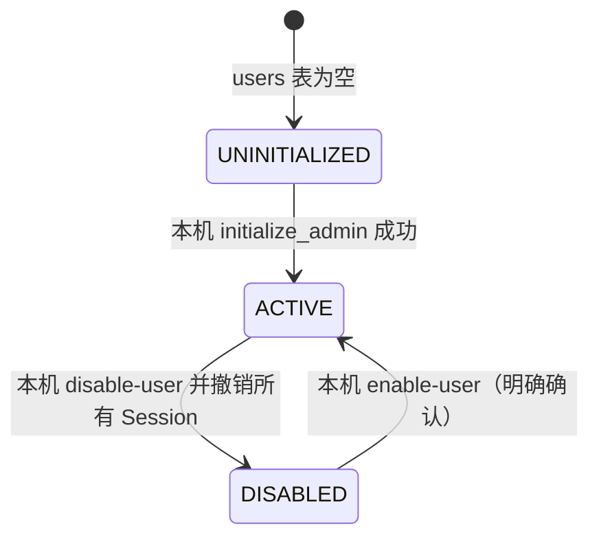
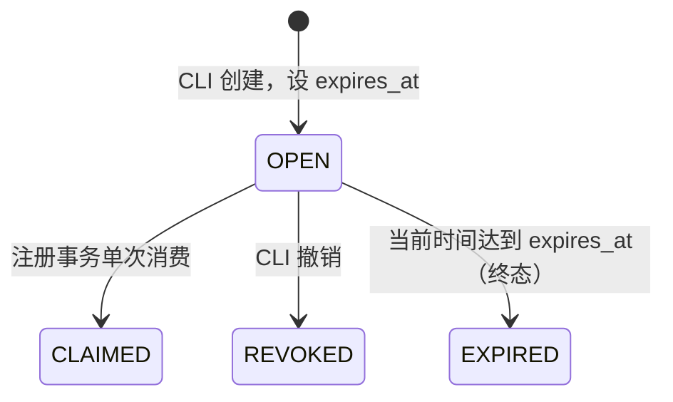

# P0.4a 账户邀请与授权契约草案

**状态：P0.4a 设计稿；P0.4b-1 已实现邀请记录/本机 CLI/单表迁移，尚未开放 Web 注册。** 当前正式发布版本事实仍为 0.3.3；本文不表示 v0.4.0 已发布。

## 当前事实与证据

- `/api/auth/status` 查询 User 数量并报告是否需要初始化；`/api/auth/setup` 只允许空库首账号初始化，production 模式返回 403。`/api/auth/login`、`logout`、`me` 已存在；没有公开注册/邀请 API。
- production 首账号由 `backend/scripts/initialize_admin.py` 在本机终端建立。脚本名称/提示使用 administrator，但当前 `User` ORM 没有 `role`/`is_admin` 字段，也没有管理 API；这不是 Web 管理员授权模型。
- `User` 有唯一 username 与 `is_active`。禁用检查在 `api/deps.py::current_user`；没有已发现的 Web 用户禁用入口。已有 `scripts/reset_password.py` 修改指定用户密码并删除该用户全部 Session。
- 密码使用 `hash_password` 的 scrypt 加盐哈希。Session Token 以 SHA-256 摘要存储，CSRF Token 当前以原值存于 `SessionToken`；Cookie 设置为 HttpOnly session、CSRF cookie、SameSite=Lax，Secure 由生产配置/HTTPS 判定。`require_csrf` 检查 CSRF 值和请求 Origin。
- 登录失败限制当前为路由模块内存字典，每进程按 IP + username 计数 5 次/分钟；重启或多 worker 间不共享，因此不满足跨进程的可靠限流契约。
- Task、Knowledge、Chat、Review、Proposal、Provider 等现有资源包含 `user_id` 或经 user-owned 父对象关联。必须继续对每个读取、写入及关联 ID 做 owner 过滤；不能以登录成功代替对象授权。
- `AIProvider`/`SearchProvider` 的数据库记录按 `user_id` 保存且按 Provider 建唯一约束，API 查询当前用户记录。API Key 使用实例级 `PERSONAL_OS_CREDENTIAL_MASTER_KEY` 加密；配置缺失时密钥服务不可用。环境变量中的 DeepSeek Key 是实例级 fallback，不是每用户凭证。多用户模式必须禁用此共享 fallback，或明确向全部用户说明共享成本/授权边界；建议首版禁用。
- Web 整库备份、备份列表和迁移导出已因没有管理员权限模型而默认 403。应继续保持 fail-closed。

证据入口：`backend/app/api/routes.py` 的 auth/setup、login/logout、account/provider 路由；`backend/app/api/deps.py`；`backend/app/auth/security.py`；`backend/app/models/entities.py::User/SessionToken/AIProvider`；`backend/app/services/provider_service.py`；`backend/scripts/initialize_admin.py`、`reset_password.py`；`app/docs/architecture/personal-os-r0-roadmap-and-acceptance.md`。

## 两种最小方案比较

| 项目 | A：本机 CLI 管理邀请/运维 | B：Web user/admin 角色与管理 API |
|---|---|---|
| 首版身份 | 操作系统本机受信任运维者；普通 Web 用户没有 admin 权限 | User 增加明确角色/权限，Web API 执行管理操作 |
| Web 功能 | 邀请码注册、自有数据 API；无邀请管理、无 Web 备份管理 | 管理员邀请/停用用户；实例级操作仍需单独授权策略 |
| 数据库变更 | P0.4a 方案草案原计划邀请码表与共享限流表；P0.4b-2a 实际新增 `auth_security_state` 承载 HMAC 限流桶和一次性 challenge；复用 `User.is_active`，不迁移旧 User 角色 | 新增邀请表及角色列/角色表；现有 User 必须显式确定角色 |
| 实现面 | CLI 签发/撤销/列出邀请，禁用账户并撤销 Session；部署文档要求限制本机 DB/CLI ACL | `require_admin`、角色管理、CSRF、权限审计、管理 API、Bootstrap/提权回收流程 |
| 部署条件 | 单实例 Windows 本地运行；DB 与 `.env` 仅限受信任操作系统账户；私有 Tailscale HTTPS | Web 管理面可达时需要更完整的网络、管理员账户恢复和审计控制 |
| 主要风险 | 主机/CLI 账户被攻破即可运维；CLI 动作没有现成的 User admin actor；单机运维可用性 | 首个管理员提权/迁移错误可能锁定实例或扩大权限；Web 管理面攻击面更大 |
| 复杂度/兼容 | 较低；保留已有用户、Session 和 `is_active` | 较高；必须安全确定旧账号角色并测试管理员丢失/恢复 |

### 推荐：v0.4.0 首版采用 A

采用“本机实例运维身份”和“普通 Web 用户身份”两层。运维身份由 Windows ACL/交互式本机 CLI 控制，不映射成可由 Web 请求声明的角色。现有 `initialize_admin.py` 只负责空库创建首个用户；它不会使该用户自动拥有 Web admin 权限。未来 CLI 邀请管理命令必须在本机账户权限下执行，不能暴露 HTTP 等价物。

这一方案最少改变现有技术栈和 User 数据；普通账户仍由 `current_user` 提供可信身份，所有业务记录仍按 owner 检查。Web 端的整库备份/恢复、邀请管理、用户停用继续拒绝或不提供。若未来必须通过 Web 管理，另立版本采用方案 B，并先设计管理员引导、审计和恢复流程。

## 账户与邀请码状态机

用户状态复用现有 `User.is_active`，不另造账户状态列：

DISABLED 用户的 Web 请求返回 401，历史资源保留，不提供自助删除状态。

邀请记录的状态由时间戳推导；过期不需要批量更新：

`CLAIMED/REVOKED/EXPIRED` 均不可再用。User 仅在邀请码成功原子消费后创建，成功状态为 ACTIVE；不创建可登录的“半注册”账户。

## 最小数据迁移草案

方案 A 不新增 User `role` 字段。邀请码使用 `registration_invites`；注册阶段另需持久化安全状态。原设计曾拟用 `auth_rate_limit_buckets` 单表，P0.4b-2a 最终采用 `auth_security_state` 同时存限流桶与短时一次性 challenge；不保存原始账号、IP、邀请码或 challenge：

| 字段 | 用途/约束 |
|---|---|
| `id` | `registration_invites` 本地记录主键 |
| `token_hash` | 随机邀请码的 SHA-256 摘要；唯一，不保存明文 |
| `created_at`, `expires_at` | 签发和失效时间 |
| `claimed_at`, `claimed_by_user_id` | 单次消费结果；User 外键可空，不能重复领取 |
| `revoked_at` | 运维撤销时间；与 claimed 状态互斥 |
| `issuer_kind` | 固定为 `local_cli`，不接受 Web 客户端提供 |

注册安全表使用 `state_hash` 主键与 `state_kind` 区分限流桶和 CSRF challenge；配有时间窗口/过期、计数和消费时间字段。迁移实现以当前 Alembic 文件为准，避免把设计字段误读为实际列。

设计要求以服务端 Secret 对限流维度做 HMAC、采用 SQLite 原子 upsert/事务，并在限流存储不可用时 fail-closed。Secret 更换会使旧桶失效，轮换要纳入运维说明。当前实现按服务端连接地址设置总量桶，并按“来源地址 + 规范化用户名”组合设置身份桶，15 分钟窗口分别限制 30 次和 5 次；匿名 challenge 按来源地址每小时限制 60 次。记录到期后由后续请求清理，不保存原始来源地址和用户名。当前策略计入所有格式合法的注册尝试，而非只计失败请求，以避免并发和业务回滚影响限流；来源总量超限后不再为不同用户名生成新桶。

原始邀请令牌只在 CLI 创建时显示一次，不写日志；创建命令应给出过期时间和安全分发提示。撤销和列表通过本机 invite ID 操作，列表不返回令牌。

P0.4b-1 的 Alembic revision 创建 `registration_invites`；P0.4b-2a 的后续 revision 创建 `auth_security_state` 和索引。不重建、不重分配任何现有 User 或业务 `user_id`，不改密码、旧 Session、Provider 凭证或历史业务数据。

邀请注册必须在一个事务里完成：条件更新 OPEN 邀请为已领取 → 创建 User → 创建初始 Session 记录并 flush → commit。任何 username 冲突、Session 插入失败或并发竞争都 rollback，使邀请仍可用或由一个并发请求成功消费。当前 `create_session` 会自行 commit，实施时需提供可加入外层事务的 Session 创建函数；Cookie 只能在 commit 成功后写入响应。

## 权限矩阵

| 主体 | 注册/认证 | Task/Knowledge/Chat/Review/Proposal/Run/文件 | Provider 凭证 | 邀请与用户管理 | 实例备份/迁移恢复 |
|---|---|---|---|---|---|
| 匿名 | 查询公开 auth status/challenge；仅有效邀请注册；登录 | 拒绝，需认证 | 拒绝 | 不允许 | 不允许 |
| 普通 ACTIVE 用户 A | 自己的登录/退出/密码与资料；不能开通任意账户 | 仅访问 owner=A 的资源；跨用户主键/关联 ID 返回既有 404/拒绝；写入有 CSRF | 仅读取/变更自己的 Provider 行；密钥不返回；共享环境 Key 首版禁用 | 不允许 | Web 默认 403 |
| DISABLED 用户 | 不允许认证；现有 Session 同时撤销 | 不允许 | 不允许 | 不允许 | 不允许 |
| 本机实例运维者 | 不作为 Web 角色；使用受保护 CLI | 不直接充当业务用户 | 维护实例配置/Key 需本机文件 ACL | CLI 签发/撤销邀请码，停用/启用用户，撤销 Session | 仅本机运维流程，保留停机、备份/恢复保护 |
| 方案 B 的 Web Admin | 本轮不推荐/不存在 | 仍受自身业务数据 owner 过滤；不得默认跨账户读取 | 不得读取明文用户 Key | 需独立管理授权与审计 | 不自动获得整库备份权限；应再设独立运维权限 |

跨用户对象默认采用不泄露存在性的 `404` 约定；`403` 用于身份已知但被明确禁止的能力（如 CSRF 失败、Web 实例备份入口）。不能把 403/404 混为一谈，也不能将普通登录用户等同于管理员。

## API 与本机 CLI 草案

| 方法/命令 | 主体 | 输入/成功 | 失败契约 |
|---|---|---|---|
| `GET /api/auth/status`（现有） | 匿名 | 是否需要初始化；注册开关/部署方法 | 不返回用户列表、邀请状态或敏感配置 |
| `GET /api/auth/registration/challenge`（拟议） | 匿名 | 短时一次性注册 CSRF challenge；响应体返回一次性值、同时设置严格 SameSite HttpOnly Cookie | 限流时 429 |
| `POST /api/auth/register`（拟议） | 匿名，持有有效邀请 | `invite_code, username, password, challenge`；201 创建 ACTIVE User 和 Session，commit 后设置 Cookie | 错误邀请使用统一不可用错误；重复 username 409；无效挑战/Origin 403；限流 429 |
| `POST /api/auth/login`（现有） | 匿名 | 凭证验证成功后创建 Session | 用户名/密码错误统一 401；超过限流 429 |
| `POST /api/auth/logout`（现有） | 当前 Session + CSRF | 删除当前 Session 并清 Cookie | 无效 Session 401；CSRF 403 |
| `GET /api/auth/me`（现有） | ACTIVE Session | 当前账号的公开概要 | 未认证或已停用 401 |
| `python -m scripts.manage_invites create --ttl-hours 168`（已实现） | 本机交互终端/OS 运维者 | 一次显示随机令牌；记录仅存摘要 | 非交互/重定向输出拒绝；不打印环境密钥 |
| `python -m scripts.manage_invites list` / `show <invite-id>`（已实现） | 本机 OS 运维者 | 仅显示 ID、状态及时间元数据 | 不返回令牌或摘要 |
| `python -m scripts.manage_invites revoke <invite-id>`（已实现） | 本机 OS 运维者 | 原子撤销未消费且未过期邀请 | 已消费、已过期、已撤销记录不可回退 |
| `python -m scripts.manage_accounts disable <username>`（拟议） | 本机 OS 运维者 | 原子停用账号并删除该用户全部 Session | 不删除其业务数据；最后一个可登录账户的停用需显式恢复流程 |
| `python -m scripts.manage_accounts enable <username>`（拟议） | 本机 OS 运维者 | 复核后重新启用 | 不恢复旧 Session；用户重新登录 |

注册 API 的匿名 CSRF challenge 绑定同源或配置 allowlist Origin、短有效期和一次消费；前端把响应体中的 challenge 回传到 Header，服务端同时校验 HttpOnly/SameSite Cookie。JSON 请求不能仅依赖浏览器 CORS。邀请码不是普通用户的管理员凭证。邀请验证失败不区分“未知、过期、撤销、已使用”，避免在线枚举状态。

## 密码、会话与限流契约

- 复用现有加盐 scrypt 验证；新注册要求至少 12 字符并至少包含三类字符，与本地密码重置规则保持一致；现有账号仍可按旧凭证登录。不得明文日志、回显、存入邀请表或测试产物。
- Session Cookie 保持 HttpOnly、Secure（生产强制）与 SameSite；原始 token 不落库。注册初始 Session 与账户/邀请消费同事务，Cookie 在 commit 后发出。
- 退出删除当前 Session；停用账号须同事务删除所有 Session；恢复账号不恢复旧 Session。定期清除过期 Session 可另行执行，但不能误删活动记录。
- 注册和登录使用共享 SQLite 原子限流桶，按来源 IP 与规范化 username/邀请摘要分别限速；现有进程内计数仅作额外短期保护，不能替代持久桶。超限返回 429，限流数据库异常时不继续校验密码/领取邀请。不得记录原始凭证。
- 初始管理员与应用用户分离：首个 User 由 `initialize_admin.py` 创建但不设置 Web 角色。Web 账户不得更新 `credential_master_key`、Session 归属、邀请码所有者或实例数据库路径。

## v0.3.3 升级和部署流程

### 全新安装

1. 安装锁定依赖并生成/验证本机配置；运行 Alembic 到 head，不通过应用启动隐式改结构。
2. 空库下用受保护本机 CLI 初始化第一个 User；该账户不拥有 Web 管理角色。
3. CLI 创建邀请，Web 用户经邀请注册；验证双用户互不可见，再开放实例的预期网络入口。
4. 无 LLM Key 时，手工登录、任务、知识和 Review 仍可用；AI 明确提示未配置并不外发请求。

### v0.3.3 老实例升级

1. 停止服务，使用已有安全本机流程创建独立备份；只在隔离副本验证恢复和 Alembic 前滚。
2. 记录当前 Alembic revision，校验副本 `integrity_check`、`foreign_key_check`、User 数、关键资源计数/指纹。
3. 备份通过后应用新增邀请码/限流表迁移。原 User、密码哈希、Session 和所有业务 owner 不改写；不自动邀请或创建额外账户。
4. 迁移后先验证原账号登录、旧资源可见性、邀请失败/成功路径和 User A/B 隔离，再开放注册。
5. 失败时停止服务并保留原库；关闭注册入口，优先以前滚兼容的应用版本恢复。不得自动 downgrade 删除新表/新账户。确需恢复备份时先写入新的 SQLite 路径，经离线核验后由运维者切换。

## 设计验收清单

- [ ] 空库首个 CLI 管理身份/首用户初始化只可成功一次；生产 Web setup 拒绝；无管理员角色伪装。
- [ ] 邀请原始值只显示一次、数据库仅有 hash；未知/过期/撤销/已用统一响应；撤销不可领取。
- [ ] 双并发领取同一邀请码只有一个 User；用户名唯一冲突、数据库错误会回滚邀请码消费和 Session。
- [ ] challenge/Origin/CSRF 成功与拒绝场景、注册与登录 429 限流、跨 worker/重启限流语义均通过隔离测试。
- [ ] 密码仅存 scrypt，退出撤销当前 Session；账号停用使全部 Session 失效；重新启用后必须新登录。
- [ ] User A/B 对 Task、Evidence、Knowledge、来源、Chat/Message、Review、Proposal、Run、ToolCall、文件、检索上下文和跨用户关联 ID 的读取/写入/删除全覆盖。
- [ ] Agent 工具只继承服务端 Run 所属用户；Provider 管理按 user_id；共享环境 Key 的多用户策略通过验收；Key 不出现在 API、日志和异常内容。
- [ ] Web 普通用户访问实例备份列表/创建/整库导出/恢复持续 403；本机安全运维备份/恢复独立验证。
- [ ] 老 v0.3.3 副本前滚迁移与新空库初始化分别验证；旧 User/Session/业务数据保留，双用户注册只创建新 owner 数据。
- [ ] 无真实 Provider 的离线 E2E、备份恢复、异常回滚、唯一约束并发竞争及关键权限审计通过后，才能请求 v0.4.0 发布验收。

## 风险与范围

方案 A 不解决主机 OS 账户被攻破，也不提供云端多实例、高可用或跨实例账户。SQLite 仍是单实例数据库。旧数据仍属于原 `user_id`；任何“拆分现有个人数据给多个新用户”的需求都需要单独的数据归属决策，不能自动复制或重新指派。

## P0.4b-1 实施状态

- **已实现：** `backend/app/models/entities.py::Invitation` 与 `registration_invites` ORM；Alembic `f4b5c6d7e8f9` 在 `f3a4b5c6d7e8` 后单链升级。字段为唯一 `token_hash`、创建/过期/领取/撤销时间、领取用户和固定 `issuer_kind=local_cli`。领取时间是已消费的权威状态，即使未来用户删除策略使领取者外键变空，也不会令邀请码恢复可用。
- **已实现：** `backend/app/services/invitation_service.py` 提供创建、状态元数据、撤销与原子领取契约。创建返回明文令牌仅供 CLI 当次显示；数据库只存 SHA-256 摘要。领取是一条带 token 摘要、未过期、未领取、未撤销条件的 SQL `UPDATE`；该 Service 不 commit，调用方必须把领取与 User/Session 写入放在同一个事务中。
- **已实现：** `backend/scripts/manage_invites.py` 本机命令 `create --ttl-hours`、`list`、`show`、`revoke`。创建只允许交互式终端输出，其他命令不显示明文或 token 摘要。命令依赖受信任本机账户对配置数据库文件的访问权，不提供 HTTP 管理入口、不新增 Web 管理员角色；主机文件 ACL 和终端录屏/转录由运维环境负责。
- **已实施且通过本轮隔离测试：** 空数据库升级、合成旧 revision 数据升级与重复升级、User/Session 保留、唯一约束、并发单次领取、事务回滚、过期/撤销/重用拒绝以及 CLI 明文输出边界。专项 7 passed；后端全量 149 passed；前端 Vitest 35 passed、TypeScript 检查通过、临时目录构建通过、Playwright 2 passed。详细记录见 `app/CHANGELOG.md` 的 Unreleased。
- **P0.4b-1 当时未实施：** Web 注册/匿名 challenge、注册事务中的 User/Session 创建、共享限流。后续实现状态见下节；停用账户命令和双用户全资源端到端验收仍待后续切片。邀请管理仍仅限本机 CLI，Web 不得创建或列出邀请。
- **回滚边界：** v0.4 应用代码回退可保留新增表，旧代码忽略该表。迁移 downgrade 会删除邀请码记录（包括已领取审计），因此邀请码开始签发后不得把 downgrade 当作常规回滚；恢复应优先回退应用、关闭注册能力并保留数据库表。前滚迁移失败时停止并保留原数据库，先在副本诊断。

## P0.4b-2a 后端注册闭环状态

- **已实现：** `GET /api/auth/registration/challenge` 签发短时随机 challenge，响应体返回值、`HttpOnly; SameSite=Strict` Cookie 持有同值；`POST /api/auth/register` 必须提供匹配 Header/Cookie、有效 Origin、邀请、规范化用户名和满足既有密码强度标准的密码。Origin 必须与请求同源或精确匹配 `PERSONAL_OS_ALLOWED_ORIGINS`；不信任 `X-Forwarded-For` 等客户端身份头。生产若由 TLS 反向代理终止，应配置对外 origin allowlist。
- **已实现：** `AuthSecurityState` 表只存 HMAC 摘要；SQLite 原子 upsert 维护来源 IP 与规范化用户名的持久窗口计数，独立事务先提交。challenge 哈希在同表原子消费且短时过期；有效格式请求即计数，过期记录被后续挑战/注册请求清理。存储不可用时返回 503 fail-closed。
- **已实现：** `register_with_invitation()` 在同一个业务 Session 事务里创建 User、原子领取 Invitation 并 flush 新 Session。`create_session_uncommitted()` 不提交，原 `create_session()` 仍保留自提交调用语义。仅业务事务 commit 返回后路由才设置 Session/CSRF Cookie。用户名冲突和任意邀请状态对外使用同一个 400 文案，避免账户/邀请码枚举；注册提交成功但响应丢失时可通过现有登录恢复，已消费邀请不能再注册。
- **已验证范围：** 临时 SQLite 下覆盖成功注册、无效/过期/撤销/已领取邀请统一拒绝、相同邀请并发仅一次成功、User/Session 失败回滚、CSRF 重放/Origin 拒绝、旧 Session 自提交兼容、独立 Session factory 读取限流状态及空库/合成旧库迁移。全资源双用户 E2E 和 React 页面不属于本切片。
- **仍未实现：** React 注册页面、浏览器端完整注册 E2E、账户停用/恢复 CLI、全资源双用户隔离验收、生产反代配置验证。旧 `/auth/setup` 的空库本机初始化兼容保持；生产初始化仍由本机 CLI 执行。
- **迁移回退：** `a6c7d8e9f0a1` 仅新增安全状态表。可先回退应用并关闭 Web 注册、保留新表；不要在运行新代码或保留已发 challenge 状态期间执行 downgrade。所有迁移仅在临时空库与合成 `f4b5c6d7e8f9` schema 副本验证。

## P0.4c-1 全资源多用户隔离验收记录

本节是本地隔离测试结果，不表示生产环境或所有 CRUD/E2E 已验收。当前身份仅来自 [`api/deps.py`](../../backend/app/api/deps.py) 的 Session Cookie；写请求还需 CSRF。资源未归属当前用户时，主要业务 API 使用统一的 404 语义，避免枚举资源；认证失败为 401，CSRF/Origin 与实例级备份拒绝使用 403。

| 资源/操作范围 | 状态 | 当前代码边界与实测证据 | 未覆盖边界 |
|---|---|---|---|
| Task 读取、列表、修改、删除、TaskEvidence | **VERIFIED（核心 API）** | `api/routes.py::_owned_task`、Task 查询约束及 `task_manager.py` owner filters；`test_mult_user_isolation.py` 双用户读/改/删/证据写拒绝，验证 Task/Evidence 数据不变；既有注册 Playwright 对 Task 读/改作跨用户拒绝。 | 所有 Task 状态/恢复/永久清除组合未逐端点在双用户浏览器覆盖；历史子行经 Task owner 详情间接保护。 |
| Knowledge、检索、Task 关联、来源 | **VERIFIED（核心 API）；PARTIAL（全部来源生命周期）** | `knowledge_service.py::_owned_card`、`retrieve_cards`、`get_active_cards`、`link_task` 按 user_id 校验；双用户测试验证检索不返回他人正文、卡片修改拒绝、卡片/任务双向跨账户关联拒绝，关系表读回为空。 | 导出、恢复、永久清理各分支未逐一双用户测试；来源记录的历史数据一致性未做数据库级审计。 |
| Chat Conversation/Message、导出和任务关联 | **VERIFIED（所有权核心 API）；PARTIAL（每个生命周期端点）** | Routes `_owned_conversation`、Message 查询及 Task 关联校验 user_id；双用户测试覆盖外人会话读取/修改/删除、消息 proposal、Task↔Conversation 关联拒绝；既有 Chat E2E/测试覆盖 owner 可见与 Run/ToolCall 归属。 | 本轮未对导出/恢复/永久清理的每种状态逐一双用户验证。 |
| Proposal/Approval | **VERIFIED（跨用户拒绝与无写入）** | `proposal_service.py::get_owned_proposal`、`apply_proposal_action` 条件更新含 `proposal.user_id`；双用户测试验证外人批准返回 404，Proposal 保持 PENDING 且没有任务生成；并发/幂等/回滚由 `test_3b0_tools.py` 等既有测试覆盖。 | 本轮没有新增并发审批浏览器覆盖。 |
| Agent Run/ToolCall/Context Builder | **VERIFIED（已有工具边界 + API 读拒绝）；PARTIAL（所有模型调用组合）** | `tool_registry.py::_assert_run_owner` 同时比较传入 User、Run ORM 与数据库 owner；`context_builder.py` 每项查询按 user_id；既有 `test_tool_registry_rejects_mismatched_run_and_user_before_read_or_audit`、Context exclusion tests 及双用户 Run ToolCall API 404 测试。 | 本轮未实际调用真实 Provider；只通过 Mock/数据库夹具验证，不能代表线上模型调用/外部成本行为。 |
| Daily/Weekly Review | **VERIFIED（当前 API 读取和跨用户任务写入）** | `routes.py` Review 读写按 user_id，Review TaskSnapshot 同时过滤 snapshot/task owner；新增测试验证 A 的日/周内容对 B 不可见且 B 不能用 A 的 Task 建快照；`test_review_workflow.py` 与 Review Playwright 补充验证。 | 所有复盘历史迁移和多时区场景不在本轮覆盖。 |
| Learning/Health | **PARTIAL** | Study、Workout、HealthMetric 列表由 `user.id` 过滤；StudyError mutation 先校验 StudyRecord owner；新增测试验证 B 列表为空且不能给 A 的记录加 StudyError。 | Health 无资源 ID 修改/删除 API；Workout/HealthMetric 全生命周期无双用户浏览器测试；部分旧记录迁移 owner 仅做静态检查。 |
| Provider 配置/凭证 | **PARTIAL（用户自有凭证授权 VERIFIED；共享 Key 策略 FAILED/待决）** | `provider_service.py::ensure_provider` 查 `(user_id, provider)`；`provider_view` 不返密文；密钥 Fernet 加密。合成测试确认无个人凭证的用户仍可经 `/api/ai/chat` 使用环境级 DeepSeek Key，尽管该用户 Provider 行为 disabled；仅调用 Mock Provider。 | 共享 Key 的用户授权、每用户费用上限与实际美元成本结算尚未定义；没有真实凭证或付费调用验证。需负责人在方案 A/B 中决策。 |
| 上传文件/主题图片/路径 | **VERIFIED（HTTP 用户归属与内容校验）；PARTIAL（NTFS 安全）** | `/api/account/appearance/background` 只接受 Session 对应 User；A 上传、B 读取 404，B 删除自身设置不影响 A 文件。PNG/JPEG/WebP 内容识别、5 MB 上限、24 MP 上限、随机文件名、`O_EXCL` 和私有响应头有测试。新增 NTFS junction 测试先复现用户目录重解析绕过，再令 `user_background_dir` 拒绝 private root、storage root、用户目录重解析。 | 正式 data 路径的继承 ACL 允许 Authenticated Users Modify、Builtin Users Read/Execute；OS 账户间文件/数据库保密性 FAILED。运行账户精确身份未在活动进程层核验。 |
| Invitation/Account/Session | **VERIFIED（基本生命周期）；PARTIAL（运维主机边界）** | Session Token 只存 SHA-256 摘要、14 天有效；退出删除当前记录，停用用户的旧 Session、过期 Session 和新登录均被拒绝；改密码默认撤销其他 Session。新增 synthetic API 测试覆盖 logout、停用、到期、失败登录无 Session；既有测试覆盖其他 Session 撤销及 Cookie 属性。 | 邀请 CLI 的实际 Windows OS ACL、活动服务进程身份未验证；操作系统 data ACL 使本机账户隔离不足。 |
| Backup / Export / Recovery | **VERIFIED（Web 备份与整库导出拒绝）；PARTIAL（上传包 validate）** | `/api/data/backups` 和 `/api/data/migration/export` 认证后 403；`test_instance_backup_web_routes_are_denied_before_side_effects` 检查副作用之前拒绝；新增测试重验导出拒绝。`/migration/validate` 仅解析用户上传包并保存当前用户时间戳，不切换数据库。 | 本轮未做本机 CLI 备份恢复双用户/损坏包/恢复后用户数据切换演练。 |

### P0.4c-1 实际执行记录

- 隔离 DB 来自 `app/backend/tests/conftest.py`：测试进程启动前设置唯一 `%TEMP%/personal_os_pytest_<uuid>.sqlite3`，启用 `PERSONAL_OS_TESTING=1` 和正式 DB 防护；测试使用合成账户、合成 Provider 密钥与本地 Mock，不读取 `.env`、备份或正式 SQLite。
- 新增 `tests/test_mult_user_isolation.py`，包含 owner 正向访问、跨用户 404/403、关联 ID 拒绝、检索不返回私有正文、凭证不回显及拒绝后 SQLAlchemy 读回断言。最终命令 `python -m pytest -q`：168 passed；定向命令：1 passed。初次测试迭代中三次失败来自该测试传入字段名/断言与现有 Pydantic 契约不符，修正后通过；没有发现生产代码越权缺陷，因此没有业务代码修复。
- 前端 Vitest 39 passed、`tsc -b` 通过、Vite 临时目录 build 成功；Playwright 经 `scripts/run-r0-e2e.ps1` 使用全新迁移 SQLite、Mock Provider、端口 8100/8200/4174，全量 5 passed（Engineering Journal、审批、Review、注册双用户）。E2E 双用户浏览器目前以 Task 为核心，不能据此声称 Knowledge/Provider/File 等浏览器端全资源覆盖。
- `tool_registry.py` 的 Run/User mismatch 与 Context Builder 过滤由已有单元/服务测试证明；此次 API 测试补全部分端到端 owner 断言，但未证明第三方 Provider 或公开部署安全。

**剩余注册阻断：** 不满足“全资源安全已完全验收”的说法；可将权限矩阵/API 核心结果作为进入 P0.4c-2 部署和恢复验收的部分证据。生产 HTTPS/Tailscale 代理、独立安装、迁移恢复和文件系统隔离仍需单独演练。

## P0.4c-3 Session、文件、Provider 与 HTTPS 安全边界

### Session 与账户

Session 生命周期由 `api/deps.py::current_user/require_csrf` 每请求查询：token 摘要不存在、到期或用户 inactive 均返回 401。退出要求 CSRF 后删除当前 Session 记录并清 Cookie；密码变更默认 `revoke_other_sessions=true`。新增隔离测试验证退出后旧 Cookie 重放、停用账户旧 Session、已过期 Session、inactive 账户无法重新登录，以及错误密码不创建 Session；既有密码变更回归验证只保留当前 Session。Cookie 为 HttpOnly Session + 可由前端读取的 CSRF Cookie，SameSite=Lax；production 启动强制 `PERSONAL_OS_COOKIE_SECURE=true`，HTTPS/Tailscale 也生成 Secure Cookie。

### 文件路径修复与 Windows ACL 阻断

**缺陷：** 原 `user_background_dir` 对解析后的 user directory 比较父目录。若某用户目录是指向同级另一用户目录的 NTFS junction，`resolve()` 后父目录仍等于共享 root，检查会通过。先用合成 SQLite 之外的独立临时文件树和 NTFS junction 使测试失败，再修改 `theme_service.py`：依次检查 `DATA_DIR/private`、`theme-backgrounds` 和 user directory 的解析路径必须仍等于预期绝对路径；目录重定向 fail closed。用户所有权仍由服务端 Session 取得，不信任 URL 中的 user id 或文件名。

**边界：** HTTP 双用户隔离、文件上传/读取/删除、大小/像素/内容检查、响应缓存与 MIME 头由 `test_k1d_theme.py` 覆盖。仅支持主题背景上传，没有通用文件 ID API；静态前端没有挂载私人目录。Windows ACL 元数据只读核查发现正式 `app/data`、`private`、`theme-backgrounds` 均继承 Authenticated Users Modify、Builtin Users Read/Execute。当前函数中的 `chmod(0700)` 在 Windows 对 ACL 失败时会吞掉异常，不能替代 NTFS ACL。没有更改正式 ACL；这使得同机其他已认证 Windows 账户可能直接读写数据库/私有目录，是 P0 Release Blocker。任务计划为 Interactive/Limited，但账户 SID 与活动服务进程身份未交叉核验。

### Provider 共享凭证策略（负责人待决）

静态入口包括 `api/routes.py::ai_chat`、`services/agent_runner.py::run_chat/run_plan/run_evening`、`api/knowledge_routes.py::refine` 和 Provider 测试连接。数据库 Provider 行按 user_id 分开，密文 Fernet 加密、API 不返回密文；但个人密钥为空时会 fallback 到全局 `PERSONAL_OS_DEEPSEEK_API_KEY`。合成 Mock API 测试实际观察到没有个人 Provider 行的用户也可触发共享 Key；即使用户行存在且 disabled，环境 Key 路径仍可通过。该测试没有真实 Key 或外网调用。

| 方案 | 行为 | 兼容性 / 风险 |
|---|---|---|
| A · 默认禁止共享 Key | Web 用户没有个人凭证时不能调用环境级 Key。 | 安全边界最清楚；会停用依赖环境 Key 的现有用户流程；须在获批后调整所有 Agent/Chat/Knowledge 入口及测试。 |
| B · 明确授权并限额 | 实例运维明确开启共享 Key；用户逐次知情/授权，并由服务端强制调用、Token/费用/速率额度。 | 保留共享 Key 部署能力；需要可审计授权、可靠硬限额与并发记账；当前只记录每用户 Token，不执行总费用额度，Provider 价格/账单也不保证精确。 |

**状态：NEEDS_DECISION，未改变现有行为。** 现有每次请求最大输出 Token、Agent 每 run 工具数及每用户 Token 统计，不构成 Provider 实际美元成本限额，也不保护实例 Key 的共享消耗。

### HTTPS、Tailscale 与代理

静态配置显示 FastAPI 只监听 `127.0.0.1:8000`，manager 检查 Tailnet-only Serve，不启用 Funnel。只读执行本机 `tailscale serve status` 返回成功，配置显示存在 HTTPS Serve 且 Tailnet only；未输出 tailnet 主机名、未向该服务发 HTTP 请求。代码层有 HTTPS/Tailscale cookie 与 Origin 测试，注册来源地址优先用 ASGI `request.client.host`，忽略客户端直接提供的 X-Forwarded-For；CSRF Origin 会参考 Host/X-Forwarded-Host，但真实 Tailscale 头部净化/客户端 IP 转发未做端到端验证。production Secure 配置可强制 Secure Cookie；公网 HTTPS/其他反向代理没有单独受支持的部署契约或测试配置。

**状态：PARTIAL / NOT VERIFIED。** Loopback 和 Tailnet-only 配置证据存在；真实远端浏览器 Origin/CSRF、Cookie、限流 IP 与 Schema Guard 在托管启动器下执行情况未实测。没有重启或改动正式服务、公开端口或启用 Funnel。

### 本轮合成回归

新增 `test_final_security_boundaries.py`、NTFS junction 检查及更稳健的 HTTPS Cookie 测试账户夹具；Mock Provider、临时 SQLite/文件目录。全量回归：后端 pytest 186 passed、前端 Vitest 39 passed、TypeScript 退出码 0、临时目录 Vite build 退出码 0、隔离 Playwright 5 passed；不会把本机 Tailscale 状态查询当作 HTTPS E2E。

## P0.4c-3a Provider Key 权限封板

负责人选择方案 A 后，Web 模型请求只允许使用当前认证用户自己的已启用 AIProvider 密文。统一 helper `provider_service.require_user_api_key(provider, user_id)` 核验 Provider 记录 user_id 与服务端可信 user_id 相同、有个人密钥且 enabled，然后解密；缺失凭证和禁用凭证在请求 Provider 前以 503 拒绝。API、Provider Settings 状态与错误响应不暴露密钥。环境 `PERSONAL_OS_DEEPSEEK_API_KEY` 不再参与普通用户 AI 调用，也不再作为其设置页的“已配置”来源。

该契约覆盖直接 AI Chat、Agent Chat、Task Manager Agent、DeepSeek 计划/晚间复盘、Knowledge 提炼和 Provider 连接测试。Tool Registry 不直接调用语言模型；联网工具仍要求当前 user_id 自己配置 Tavily。`run_plan`/`run_evening` 的本地 `mock` 路径没有 Provider 请求，保留为离线验收能力。未发现单独无人触发的模型后台任务。

旧默认账户只依赖进程 DeepSeek Key 时，必须本人到“设置 → 模型 Provider”输入并保存/启用自己的 Key 后，才能恢复以上 AI 功能；不从 `.env` 自动复制密钥。未配置时 Chat/Agent/提炼及 Provider test 提示设置个人凭证；非 AI 任务、知识、复盘和本地 mock 功能保留。该变化不迁移历史 Token，也不能把之前的共享账户费用归属到某个用户。

先失败后修复的共享 Key 测试验证旧实现会调用 Mock Provider；修复后专项 13 passed、后端全量 195 passed、前端 Vitest 39 passed、TypeScript 与临时 Vite build 退出码 0、隔离 Playwright 5 passed、`git diff --check` 退出码 0。未使用真实 Key/Provider、未读取 `.env` 内容、未改变备份包或数据库 schema。上一节 Windows ACL 同机账户隔离及真实 Tailnet HTTPS 验收仍为发布阻断。P0.4c-3a 时的测试与调用入口详见[工程总账](PROJECT_ENGINEERING_LEDGER.md#p04c-3a-provider-key-权限封板)及 [v0.4.0 更新日志](../../CHANGELOG.md#v040--unreleased开发中未发布)。
