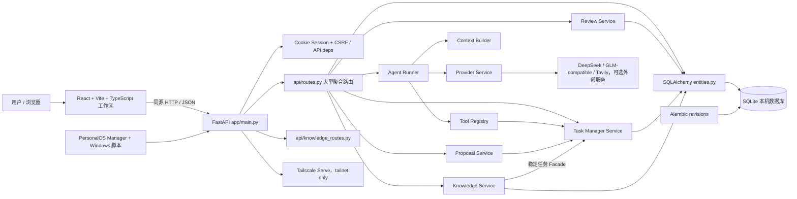
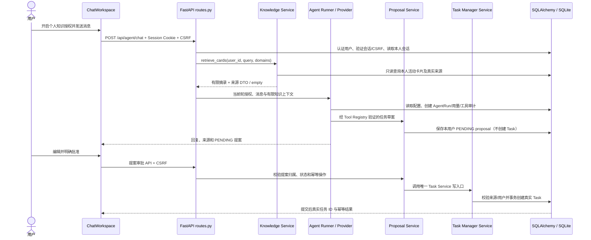

# Personal OS AS-IS 架构与证据盘点（R0）

审计日期：2026-10-19。工作目录：`<APP_ROOT>`。本报告只读检查源码、测试、文档和 Git 元数据；未启动服务、未连接数据库、未运行测试。

状态术语：**EXISTS** = 源码中存在；**PARTIAL** = 有部分实现或有限验证；**MISSING** = 未发现实现；**NOT VERIFIED** = 本轮无法确认运行/部署行为。代码存在、测试存在和端到端验收是不同证据等级。

## 版本与仓库事实

- Git 分支：`develop/v0.4`。HEAD `1569b04`，提交标题 `release: Personal OS v0.3.3`；HEAD 同时标记 `main`、`v0.3.3`。近端提交还有 `19780aa`（tag `v0.3.2`）。本地 tags 为 `v0.3.2`、`v0.3.3`，没有 v0.4 tag。
- `app/release_history.json` 的 `current_version` 为 `0.3.3`，roadmap 将 `0.4.0` 标为 `in_development`。`app/backend/pyproject.toml`、`app/frontend/package.json` 和 FastAPI `app/backend/app/release_history.py` 的产品版本也为 `0.3.3`。
- 结论：**最后正式/本地发布基线为 v0.3.3；v0.4.0 是工作区中的开发候选，不是已发布版本。** `app/CHANGELOG.md` 是开发记录；`release_history.json` 明确自称唯一产品发布源。
- 配置了 `origin https://github.com/JXcloudforge/personal-os.git`。尝试只读打开该页面返回 404；仓库文档称它是 Private 候选仓库。本轮无法从远端核验可见性、远端 refs、已推送对象、secret scanning 或 GitHub Release。不得据此宣称公开仓库已审核。
- Git 工作区有 9 个已跟踪文件修改和多个未跟踪文件/目录；包括 Review UI/后端/契约/测试、`release_history.json`、更新记录、v0.3.3 验收文档，以及仓库根部个人 OS 日志/计划文件和 `archive/`、`tools/`。这些均属用户已有状态，本轮保留。未跟踪清单以本审计开始时的 `git status --short --branch` 输出为准。
- `.env` 被 `.gitignore` 忽略，`.env.example` 被跟踪；`app/data/` 被忽略。定向 `git ls-files` 未列出实际 `.env` 或 SQLite 数据库。本轮不读取 `.env` 或数据库内容。没有发现仓库 LICENSE 文件；远端内容和历史提交仍未检查，故密钥、真实个人数据、数据库及许可风险的远端结论为 **NOT VERIFIED**。
- 本轮没有运行 pytest、Vitest、Playwright、类型检查或构建。文档里记录的历史测试数只是历史报告，不是本次独立复验。

## AS-IS 调用与组件图

部署记录是 Windows 私有主机、FastAPI loopback `127.0.0.1:8000`、PersonalOS Manager、Tailscale Serve；不是独立云服务或 Docker 部署。仅查文档/配置，未检查运行进程或正式健康状态。

## 主要模块职责、契约和证据

| 模块 | 入口与职责 | 输入 → 输出 | 数据归属/依赖 | 测试证据（文件存在；本轮未运行） |
|---|---|---|---|---|
| 前端 | `app/frontend/src/main.tsx`；登录、聊天、任务、知识、复盘、设置工作区；Vite build | 用户事件 → `/api/*` JSON/页面状态 | 不直接连 DB；依赖 API DTO | `app.test.tsx`、`ChatWorkspace.test.tsx`、`TasksWorkspace.test.tsx`、`KnowledgeWorkspace.test.tsx`、`DailyReviewWorkspace.test.tsx`；`playwright.config.ts` |
| API / Auth | `backend/app/main.py`、`api/routes.py`、`api/knowledge_routes.py`、`api/deps.py`；HTTP、会话、CSRF、错误映射 | Cookie/请求 DTO → 响应 DTO、业务副作用 | 直接使用 SQLAlchemy Session，当前路由跨域直接查询多个 ORM | `test_api.py`、`test_runtime_security.py`、`test_credential_restart.py` |
| ChatWorkspace / Agent | UI `ChatWorkspace.tsx`；`routes.py:/agent/chat` → `agent_runner.py` | 消息、会话、当前轮授权/知识同意 → 回复、Run/工具审计、可选提案 | Conversation/Message、AgentRun/ToolCall/Proposal；Context Builder、Provider、Tool Registry | `test_chat_workspace.py`、`test_agent_intent.py`、`test_3b0_tools.py` |
| Tasks | UI `TasksWorkspace.tsx`；`/tasks`、`/task-manager/*` → `task_manager.py` | 当前用户任务 DTO/编辑/幂等 operation → Task、Evidence、历史 | Task Service 当前权威写入口；SQLite `tasks` 与关联记录 | `test_k2a1_task_manager.py`、`test_k2a_timeline.py`、前端 `TasksWorkspace.test.tsx` |
| Knowledge | UI `KnowledgeWorkspace.tsx`；`knowledge_routes.py` → `knowledge_service.py` | 卡片 CRUD/检索/来源/关联 → 用户范围 DTO、知识草稿/记录 | Knowledge ORM 表；任务引用调用 `task_manager` Facade | `test_knowledge_api.py`、`test_knowledge_refinement.py`、前端 `KnowledgeWorkspace.test.tsx` |
| Review | UI `DailyReviewWorkspace.tsx`；daily routes 和未提交的 `/reviews/weekly` → `review_service.py` | 用户复盘、任务快照 → 自报记录与只读周聚合 | DailyReview/Snapshot；TaskEvidence 经 Task Service | `test_review_workflow.py`、`DailyReviewWorkspace.test.tsx`（两者本地未跟踪，均未执行） |
| Proposal / Agent 审计 | `proposal_service.py`、`agent_audit.py`、`tool_registry.py` | 经 Schema 验证的提案/审批 → PENDING/REJECTED/真实 Task 引用与 Run 审计 | Proposal/Run/ToolCall/Usage；批准写 Task 委托 Task Service | `test_agent_intent.py`、`test_3b0_tools.py`、`test_k1_release.py` |
| DB / 迁移 / 备份 | `database.py`、`models/entities.py`、`alembic/versions/*`、`backup_service.py` | ORM/迁移/备份包 → SQLite 历史与可验证迁移材料 | 单 SQLite 文件；Alembic 为结构版本 | `test_database_path_stability.py`、`test_backup_restore.py`、多个迁移测试 |
| 运维 / 部署 | `app/scripts/personal_os_manager.ps1`、`scripts/windows_service.py`、运维文档 | Start/Stop/Status/Restart → 本机托管 API | Windows 用户会话、本机数据、Tailnet | `test_windows_service_entry.py`、`test_manager_lifecycle.py`；真实重启/登录自启结果见历史报告，不是本轮验证 |

## 真实请求时序：知识辅助聊天草案并获批为任务

该链路有 2026-10-14 的隔离 SQLite + Mock Provider + 浏览器 R0 历史验收报告（`docs/releases/v0.3.3-r0-acceptance.md`）；本轮未重跑，不能推及真实付费 Provider、生产用户操作或 v0.4 修改。

## 边界审计发现

- 符合既定边界的局部：Knowledge Service 将任务引用委托给 Task Manager DTO/Facade；Proposal Service 的正式 Task 创建调用 Task Service；R0 Review 契约明确周总结只读，Knowledge 草稿只有用户保存才持久化。
- 已见跨域实现耦合：`services/review_service.py` 直接查询 `Task` ORM；`services/context_builder.py` 直接读取 Task、DailyReview、StudyRecord、UserGoal 等多个域 ORM；`services/proposal_service.py` 直接读取任务/聊天/复盘/用户模型；`services/tool_registry.py` 同时查任务、学习、搜索配置、Agent Run/Proposal。`api/routes.py` 集中导入和直接读写绝大多数 ORM，并含内嵌 SQL 查询。
- 因而“API/Service 分离”只有部分落实。当前不建议在 R0 扩大重构；先为 R1 新域定义 DTO/Facade，新增代码不复制上述跨域访问模式。后续若重构须单独切片、保留既有契约并增加边界测试。
- `DailyTaskSnapshot` 的自报状态不是正式 Task 状态；TaskEvidence 经任务服务写入；Review 周视图是已有 Review 记录聚合。不要将它们混同为目标达成或预测校准证据。

## 功能清点与验证级别

| 能力 | 状态 | 证据判断 |
|---|---|---|
| 聊天会话创建、历史分页/导出、改名/归档/恢复/删除 | PARTIAL | API/UI/测试文件存在；完整每条状态转移的当前运行验收未重跑 |
| Knowledge 卡片、来源/Run/消息关联、任务关联、回收恢复和导出 | PARTIAL | Service/API/测试存在；检索与审批历史 E2E 有隔离验收报告，非当前实测 |
| Task 创建、更新、证据和聊天/知识来源关联 | PARTIAL | Task Service/API/UI/测试存在；知识转任务授权链有 v0.3.3 历史隔离 E2E |
| AI 草案与人工审批、幂等与拒绝 | VERIFIED（历史限定） | 历史 R0 报告记录 Mock Provider + 浏览器 + 隔离库端到端通过；本轮未独立复验，生产/真实 Provider 不包含在该结论 |
| 来源引用与跨用户读取拒绝 | PARTIAL | 代码与 account/knowledge 测试覆盖；历史 R0 验证本人来源 UI；当前无测试运行 |
| 复盘每日读写、任务快照 | PARTIAL | 原有 API/UI/测试；v0.4 未提交分支修改未经执行 |
| v0.4 周汇总、Task Evidence 收口、复盘转 Knowledge 草稿 | PARTIAL | 未提交代码/测试/契约已存在；本轮未运行，不能验收 |
| 用户登录、退出、scrypt 密码哈希、Session/CSRF | PARTIAL | `/auth/setup` 是首账号一次性初始化，`/auth/login`、logout/me 存在；无公开多用户注册流程。历史单用户功能与多租户产品能力需区分 |
| 多用户隔离 | PARTIAL | 多处有 `user_id` 过滤，迁移及隔离测试文件存在；账户隔离测试未本轮执行，端到端多用户部署尚无证据 |
| 消息复制按钮 | VERIFIED（历史限定） | v0.3.3 R0 报告称 Chromium 剪贴板对用户/AI 消息通过；生产登录 UI 未验证，本轮不复验 |
| 自助注册/邀请、租户生命周期 | MISSING | 未发现注册/邀请/租户管理闭环；初始 Setup 在已有用户时拒绝 |
| 贝叶斯信念、决策效用、现实结果与校准 | MISSING | 未发现对应领域模型/计算服务/API；现有 UserGoal、Agent 建议和 Review 不能代替 |
| 外部情报标准接入 | MISSING | 仅 Tavily Agent 工具，不是独立情报系统的版本化接入契约 |

## v0.3.3 / v0.3.4 历史发布阻断复核

- 仓库中找不到 `v0.3.4` tag、CHANGELOG 条目或专门阻断台账：**v0.3.4 事实为 NOT VERIFIED**，无法按不存在的台账逐条复核。
- v0.3.3：本地 tag/commit 和隔离 R0 报告存在；`CHANGELOG`/验收报告记录远端 push/GitHub Release 未完成（本机 Git HTTPS 连接失败），因此 GitHub 发布未达成。
- v0.3.3：历史验收记录生产登录态系统信息返回 401，故生产设置、任务/知识读取、消息复制等 UI 流程未验收；Manager 重启后健康/数据库检查通过但有 `previous_run_missing_exit` ERROR，不能称无异常。
- 历史报告：真实付费 Provider 回答质量和正式库审批未测；用户当前 PENDING 提案未被操作；登录自启、Windows 重启和异常恢复仍为 Pending。上述是报告记载，不是本轮 live 检查。
- `release_history.json` 在工作区被修改，当前 diff 将历史 0.3.3 limitations 改为更明确状态，且更改 roadmap 的 0.4 名称。因为该文件未提交，不能将其改写当作正式发布事实。
