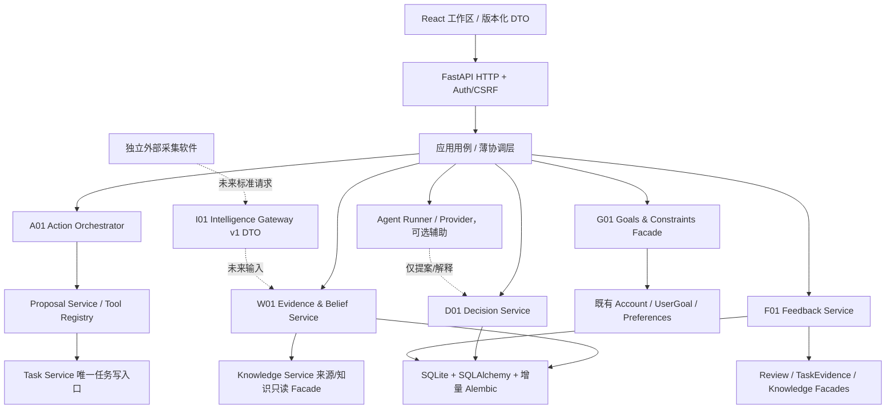

# Personal OS TARGET 架构与领域契约（R0 提案）

状态：逻辑架构和接口草案，未实现、未批准为 schema。日期：2026-10-19。保留现有单体网站、框架、数据库及部署；不要求拆分服务或引入新基础设施。

## 目标架构



`应用用例`表示现有 FastAPI 单体中的薄协调层，不意味着新增框架。域内部可以封装 ORM 和 SQL；跨域只传 DTO/Facade。API 层不拼接业务 SQL。Agent/LLM 不拥有概率计算、效用规则、数据库写入或审批权。

## 领域职责和模块边界

| 域 | 负责 | 不负责 | 依赖/持久层 |
|---|---|---|---|
| G01 Goal & Constraint Model | 用户目标、优先级/价值偏好、有效时间段、预算/能力/风险硬约束与软偏好 | 把期望资源记成现有资源；替用户做价值选择 | R1 先适配 `UserGoal` 与 Account DTO；只有差异明确后再增量持久化 |
| W01 World Model & Bayesian Belief | Evidence、Hypothesis、Reference Class、先验/似然/后验、证据依赖分组、更新历史与限制 | 外部爬取、知识卡审核、LLM 直接报精确概率 | 新域封装自身 Repository/ORM；以 Knowledge Source DTO 作可选引用 |
| D01 Decision Engine | DecisionCase、ActionOption、情景、效用/成本/风险/可逆性、VOI、版本化计算 | 执行任务、自动重写目标 | 纯计算模块 + 自有 DTO，必要时其自身读写持久化 |
| A01 Action Orchestrator | 已确认 ActionIntent、审批状态、幂等键、Task/Project/Run 引用和执行结果状态 | 第二份 Task 表、绕过 Proposal/Task Service | 通过 Proposal/Task Service 稳定契约写入；仅在需要持久化意图后设计域实体 |
| F01 Feedback & Learning | 预先定义的指标、预测与现实结果、来源/核验级别、偏差及样本充足度 | 将自报等价于验证、直接宣称因果 | Review/Task Evidence/Knowledge Facade；校准服务确定性和可复现 |
| I01 External Intelligence Gateway | 标准版本、来源身份、去重/幂等、校验错误和候选状态 | 直接查采集软件 DB、自动把外部输入升级成事实 | R0 仅文档契约；未来通过 HTTP DTO/签名/服务账号接入 |

## 最小领域对象候选

| 对象 | 最少字段/不变量 | 来源与状态 |
|---|---|---|
| `GoalConstraint` | `id,user_id,kind,polarity(hard/soft),unit,value,valid_from,valid_until,source,status`；区分当前资源与期望资源 | 映射既有 UserGoal/设置；仅在不足时扩展，不复制目标表 |
| `DecisionCase` | `id,user_id,title,question,objective,horizon,status,created_at,updated_at,version`；状态包括 draft/assessed/approved/closed | 新决策域；拥有假设、证据和选项的聚合根 |
| `Hypothesis` | `id,case_id,statement,reference_class,prior_probability,scope,version`；概率范围 [0,1]，先验来源必填 | 隶属 DecisionCase；彼此不自动视作穷尽或互斥 |
| `EvidenceRecord` | `id,user_id,claim,source_uri/source_kind,observed_at,scope,credibility,verification_status,duplicate_key,dependency_group,created_at` | 允许人工证据；Knowledge 关联是来源引用，不把知识卡内容复制进证据事实 |
| `EvidenceAssessment` | `evidence_id,hypothesis_id,likelihood_if_true,likelihood_if_false,assessor,method,version` | 显式输入/审核的似然；基础率另存来源与统计口径；相关证据不可重复当独立证据连乘 |
| `BeliefSnapshot` | `case_id,hypothesis_id,prior,likelihood_inputs,posterior,formula_id,formula_version,input_hash,limitations,created_at` | 追加历史，不覆盖旧判断；数值由确定性函数计算 |
| `ActionOption` | `case_id,title,description,resource_costs,reversibility,risk_limit,scenario_set`；情景结果/效用保持结构化 | 多方案；不把推荐选项限制成固定数量 |
| `DecisionAssessment` | `case_id,option_id,scenario_probabilities,utilities,expected_utility,opportunity_cost,voi,calculation_version,inputs_hash,limitations` | 概率和效用独立输入，计算可重放 |
| `ActionIntent` | `case_id,option_id,approval_status,idempotency_key,approved_by,task_ids,proposal_id,operation_id,execution_status` | 决策与正式 Task 分开；Task ID 是关联，正式创建只走 Task Service |
| `OutcomeRecord` | `intent_id,metric,expected_value,actual_value,unit,observed_at,evidence_refs,verification_status,deviation` | 可为空/未知；需预先定义结果指标，不从 Task.status 推导目标成功 |

字段表是候选语义，不是最终 SQLAlchemy schema。JSON 仅用于有版本号和可校验 Schema 的不可独立查询快照；核心关系、所有权、幂等键应使用显式列/外键/唯一约束。

## 计算接口草案

纯函数接口（无 DB、网络或 LLM 副作用）：

```text
update_belief(input: BeliefUpdateInput) -> BeliefUpdateResult
assess_options(input: DecisionAssessmentInput) -> DecisionAssessmentResult
```

- Belief 输入：互斥/完备假设声明（若不满足则拒绝分类分布计算）、显式先验、证据评估列表、依赖组、公式版本与舍入精度。
- Belief 输出：未舍入/展示后验、每项中间数值、证据纳入/排除原因、输入 hash、公式版本、限制/UNKNOWN。
- 禁止把条件相关证据当独立证据相乘；缺似然、口径不一致、概率归一化非法时返回结构化 `INSUFFICIENT_EVIDENCE` / `INVALID_MODEL`，不猜数字。
- 选项输入：按结果情景拆分概率；效用、现金/时间/能力资源成本、风险上限、可逆性和用户偏好分别提交。
- 选项输出：逐情景期望效用、机会成本、风险约束结果、信息价值假设、公式/实现版本及限制；人工可覆盖推荐并记录理由。
- 效用权重必须由用户明确配置或在单个 DecisionCase 中显式确认，不允许模型静默设置。

## API / Service 契约草案

建议 API 前缀 `/api/decisions/v1`，以下均为候选接口：

| 操作 | 输入 | 输出/失败契约 | 权限与副作用 |
|---|---|---|---|
| `POST /cases` | title、question、objective、horizon、约束 DTO | 创建 `draft` case；非法时间/约束返回 422 | Session 用户归属，CSRF；只写 Decision 域 |
| `GET /cases`、`GET /cases/{id}` | 分页/状态过滤 | 只返回当前用户 Case 与引用；非本人统一 404 | 登录；只读 |
| `POST /cases/{id}/hypotheses` | statement、scope、参照群体、prior 和依据 | 返回新 Hypothesis；不完整基础率返回 422 | CSRF；case 所有权校验 |
| `POST /cases/{id}/evidence` | claim、source、date、scope、credibility、verification、dependency group | 返回 EvidenceRecord；来源无效可保留为 `UNVERIFIED`，绝不自动升级 | CSRF；当前用户本人记录 |
| `POST /cases/{id}/belief-updates` | 假设、显式先验、EvidenceAssessment、formula version | 返回可重放 BeliefSnapshot；不足则结构化 409/422 并记录原因 | CSRF；追加历史，不覆写旧 snapshot |
| `POST /cases/{id}/assessments` | 备选项、情景概率/效用/成本/风险/偏好 | 返回可解释比较及输入 hash；约束冲突返回 422 | CSRF；纯计算完成后持久化 assessment |
| `POST /cases/{id}/action-intents` | option id、编辑后 action、确认意图、幂等键 | 返回 PENDING `ActionIntent`/Proposal；相同键同结果，不同请求 409 | 只建立提案，不创建任务 |
| `POST /action-intents/{id}/approve` | 用户明确批准、确认版本/hash | 返回提交后的 Task IDs；失败保持 pending 或明确失败状态 | 登录+CSRF+所有权；调用 Task Service，事务/幂等规则明确 |
| `POST /action-intents/{id}/outcomes` | 预定义 metric 的实际值/来源/核验级别 | 返回追加结果；未知值允许明确留空 | 登录+CSRF；不自动改 Task 或假设状态 |
| `POST /cases/{id}/feedback` | 结果引用、偏差说明、是否人工覆盖 | 返回 feedback/校准资格；样本不足则 `NOT_ENOUGH_DATA` | 登录+CSRF；不得未经审核更新其他 case |

每个写 API 的 `user_id` 只能由 Session 注入；不得信任客户端 ID。所有多表写须原子提交；错误返回稳定业务码和 request_id；Agent 不获得这些接口的越权凭证。

## I01 外部情报接口（只设计，不实现）

建议版本化 HTTP 契约：`POST /api/intelligence/v1/signals`。外部程序提交：

```json
{
  "schema_version": "1.0",
  "source_system": "external-collector-id",
  "source_record_id": "stable-source-id",
  "idempotency_key": "collector-owned-unique-key",
  "observed_at": "RFC3339 timestamp",
  "published_at": "RFC3339 timestamp or null",
  "source": {"uri": "https://...", "title": "...", "content_hash": "sha256:..."},
  "claim": {"text": "normalized factual claim", "scope": "...", "language": "..."},
  "provenance": {"collector_version": "...", "retrieval_method": "..."}
}
```

- 响应：`202 accepted` + `signal_id/status=UNVERIFIED`；重放相同幂等键返回同一 ID；相同键不同内容 409；格式无效 422；认证失败 401/403。
- 输入落为候选 Evidence，须来源校验、去重、范围/时间核验和用户审核后才能进入决策计算。不得自动成为 VERIFIED 或触发行动。
- 传输身份、请求签名/轮换、限流、大小/频率预算、保留期和删除权应在外部接入实现前另立 Contract；R0 不创建共享密钥，不接 DB。
