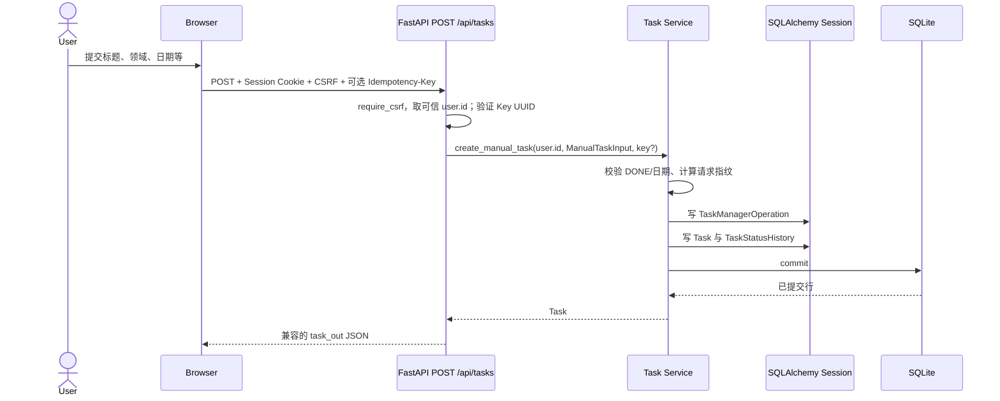
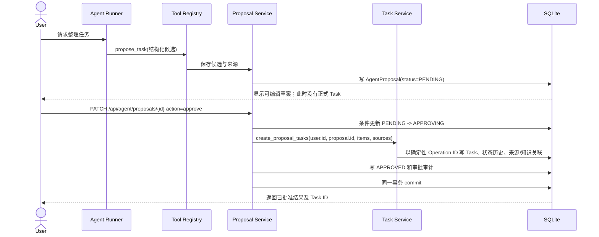

# Task Lifecycle：调用链、事务与幂等

本文按当前 `develop/v0.4` 工作区代码说明任务生命周期。发布版本仍为 0.3.3；P0.3e 的回归证据据负责人验收记录及本工作区测试记录，不能据此宣称 v0.4.0 已发布。

## 手动任务创建

当前后端契约为 `POST /api/tasks`。现有 Tasks Workspace 主要通过任务管理员/草案交互写任务；本阶段 Playwright 从登录后的真实浏览器 Session 发起该 HTTP 请求，因为当前界面没有独立的手动创建表单。请求有 CSRF Header，认证身份从服务端 Session 解析，不接受 body 中的 `user_id`。

入口：`backend/app/api/routes.py` 的 `create_task`；请求契约：`schemas/api.py::TaskIn`；Service 契约：`services/task_manager.py::ManualTaskInput` 与 `create_manual_task`。Service 通过 `_resolve_task_dates` 处理日期，通过 `_persist_task` 分配 ID 并写入 Task/状态历史。成功时写 `TaskManagerOperation` 并提交；HTTP 层只将 Task 映射为原有响应。

`Idempotency-Key` 是可选 UUID Header。Service 以用户、操作键和请求指纹决定是否回放。相同用户、相同键、相同请求回读原 Task；相同键用于不同请求返回 409。没有该 Header 时生成新的 UUID，所以旧客户端每次新提交仍会创建一条任务。

## Agent Proposal 到正式 Task

当前入口位于 `backend/app/api/routes.py` 的 Proposal 决策路由；归属读取在 `services/proposal_service.py::get_owned_proposal`。`apply_proposal_action` 用带 user/status 条件的更新抢占 PENDING 状态；成功后调用 `_create_tasks_from_proposal`，再经 `task_manager.create_proposal_tasks` 和 `create_tasks` 写入任务，最后将 Proposal 设为 APPROVED 并提交。异常时 Proposal Service rollback。

### 状态和 ID 各自代表什么

| 字段/状态 | 含义 | 是否正式任务 |
|---|---|---|
| `user_id` | 可信用户身份及资源所有者 | 否；授权边界 |
| `proposal_id` | `AgentProposal.id`，标识待审草案 | 否 |
| Proposal `PENDING` | 草案等待用户审阅/批准 | 否；尚未创建 Task |
| Proposal `APPROVING` | 当前审批事务已原子认领草案 | 否；中间状态，不应作为成功响应 |
| Proposal `APPROVED` | 审批事务已提交 | 代表批准完成，不是 Task ID |
| `operation_id` | `TaskManagerOperation.client_operation_id`，标识某次可检查/重试操作 | 否；同用户唯一 |
| `task_id` | `Task.id`，标识数据库中的正式任务 | 是 |
| Task `TODO` | 正式待办任务的起始状态 | 是；由人工请求或已批准 Proposal 创建 |

Proposal 操作键通过 UUID5 从 Proposal ID 与条目序号确定生成；手动请求通过可选 Header 提供 UUID，旧客户端则由服务端生成 UUID4。数据库已有 `uq_task_manager_operation_user_key`，唯一范围为 `(user_id, client_operation_id)`。Task ID 是单独的整数主键。四者语义不同。

## Commit、Rollback、唯一约束和重试

- Proposal 的 `PENDING -> APPROVING` 是带旧状态条件的原子更新。只有一个并发事务能认领成功；Task、状态历史、来源关联、操作记录、Proposal `APPROVED` 与审计由同一个事务提交。
- 失败时回滚整个 Proposal 审批事务。已存在的来源归属失败测试确认：Proposal 仍为 PENDING，未留下 Task 或 TaskManagerOperation。
- `TaskManagerOperation` 上的唯一约束是操作键的数据库防重保证，不依赖先查后写的应用逻辑。重放时还检查请求指纹/操作模式，防止把不同请求当作同一结果。
- 提交成功而 HTTP 响应丢失时，重试读取已完成状态或原 Task。Proposal 已批准时重复批准返回 APPROVED，不再新建 Task；手动调用方需复用原 Header 才能回放，未传 Header 的旧客户端无法用新 UUID 识别丢失响应前的操作。
- SQLite 并发测试以独立临时文件数据库和两个 Session 并行批准同一 Proposal；判定条件是恰有一条 Task、一条已应用操作记录，两个调用结果分别包含 1 和 0 个新建 Task。

## 校验与有意保留的差异

手动与 AI 创建共用 `_resolve_task_dates` 和 `_persist_task` 的正式持久化/状态历史入口。状态历史表和写入函数相同，原因值保留来源差异：手动为 `created`，AI 为 `created_by_task_manager`。手动 `TaskIn` 支持原 API 字段，包括可选初始状态、`task_code` 和 `planned_due`；新增 Task 以 DONE 开始仍被拒绝。AI `TaskItemInput` 对模块枚举和字段长度约束更严格，只创建 TODO，并从 Proposal 构造来源引用及 AI task code。

重复判断也按既有产品语义区分：AI Task Service 按认证用户、未删除任务、领域和规范化标题返回重复项；手动 `POST /api/tasks` 原来允许同名任务，本轮继续允许。P0.3e 测试覆盖这一兼容性，避免把 AI 去重规则静默施加到手动 API。两条路径都写 Task 状态历史，但使用不同的 `reason`；Proposal/AI 路径另写审批与 Task Manager 审计事件，手动任务保留其操作记录而不伪称产生 Agent 审批事件。

## HTTP 状态码在本项目中的用法

| 状态 | 当前实际场景 | 依据 |
|---|---|---|
| `403` | CSRF Token/Origin 校验失败；生产环境禁止 Web 首账号初始化；备份、备份列表、整库迁移导出因无管理员授权而默认拒绝 | `api/deps.py::require_csrf`；`api/routes.py::setup` 与 `/data/backups`、`/data/migration/export` |
| `404` | Task 或 Proposal 不存在、已删除不可访问或不属于当前用户时，按 user_id 查询并返回资源不可用；不暴露跨用户对象是否存在 | `api/routes.py::_owned_task`、`services/proposal_service.py::get_owned_proposal` |
| `409` | 首次 Setup 已完成；手动幂等键重用但请求内容不同；Proposal 审批正在进行；或资源状态不满足操作前提 | `api/routes.py::setup`、`create_task`、Proposal 决策路由 |

认证失败通常为 `401`，与以上授权/状态冲突语义分开。

## 三个真实工程问题与证据

### 1. 手动 Task 路由绕过 Task Service

旧 `POST /api/tasks` 在路由中直接构造 Task ORM、写状态历史并 commit，手动路径因此没有经过正式 Task Service 入口。P0.3e 先运行服务委托探针，旧实现失败（路由调用次数为 0）；修复后 `routes.create_task -> create_manual_task -> _persist_task`，同一测试通过。回归还验证原响应、状态历史和同名任务语义。代码：`api/routes.py::create_task`、`services/task_manager.py::create_manual_task`、`test_k2a1_task_manager.py::test_manual_task_api_delegates_persistence_to_task_service`。

### 2. Agent Run/User 归属不匹配

真实 Tool Registry 检查发现，工具执行不能只相信调用方传入的用户 ID；内存 AgentRun 和数据库持久化 AgentRun 的 user_id 都必须等于认证用户。当前 `_validate_run_owner` 在工具读取、执行或审计副作用前拒绝不匹配，并回传 `AGENT_RUN_NOT_OWNED`。测试在 `tests/test_3b0_tools.py::test_tool_registry_rejects_mismatched_run_and_user_before_read_or_audit` 检查拒绝且没有 ToolCall 副作用。

### 3. Proposal 重复/并发批准

只在批准前做普通 SELECT 会让两个请求都观察到 PENDING。当前修复在 `proposal_service.py::apply_proposal_action` 中条件更新状态并将审批与 Task 写入放进同一事务；Task Service 的用户范围唯一操作键提供数据库防重，已批准请求重试会读到已完成状态。证据包括 `test_3b0_tools.py::test_native_proposal_requires_query_and_approval_then_is_idempotent`、`test_distinct_proposals_receive_distinct_task_operation_ids`、`test_concurrent_approval_of_same_proposal_creates_one_task` 和 `test_proposal_approval_rolls_back_task_when_source_is_not_owned`。P0.3e 最终全量后端为 142 passed。

这些测试证明本地隔离数据库中覆盖的代码路径；不等同于多进程/多主机数据库能力，也不代替 v0.4 发布验收。

## 两分钟中文面试讲述稿

我在 Personal OS 的 v0.4 开发阶段处理过一次任务写入边界问题。系统原来有两条正式任务路径：AI Proposal 审批会进入 Task Service，但手动 `POST /api/tasks` 路由直接写 Task ORM。这样会让日期、状态历史、幂等和授权规则逐渐分叉。我先加了一个能证明路由绕过 Service 的测试，再把手动入口收敛到 Task Service，并用 Service 自己的 `ManualTaskInput` 作为内部契约。

AI 路径仍然先产生 `PENDING` 的 Proposal；这只是候选，不是正式任务。用户批准时，服务用条件更新把 Proposal 原子认领为 `APPROVING`，再通过 Task Service 创建 `TODO` Task，并在同一个事务中写操作记录、来源关联和审批状态。异常会 rollback。`proposal_id`、`operation_id`、`task_id` 和 `user_id` 分别表示草案、可重试操作、正式任务和所有者。数据库对用户范围的操作键有唯一约束；手动 API 可以用 UUID `Idempotency-Key`，相同键和相同请求重放原任务，不同请求返回 409。旧客户端不传键时继续允许重复同名创建，保留了原有语义。

我也验证了 Agent Run 与请求用户不匹配时会在工具副作用前被拒绝，并在隔离 SQLite 上测试同一 Proposal 的并发批准只有一个正式 Task。当前工作区实测是后端 142 项、前端 35 项和 Playwright 2 项通过。这个结果证明了已覆盖的本地路径；邀请注册、全资源双用户验收、独立安装和 v0.4 发布仍是后续工作。

## English interview version

During Personal OS v0.4 development, I found that AI-approved tasks went through the Task Service, while the manual `POST /api/tasks` route wrote Task ORM rows directly. I added a regression test that failed on the old route, then moved the manual write behind a service-level `ManualTaskInput` contract. Both paths now share the core date handling, Task persistence, and status-history write.

An AI proposal stays `PENDING` until a user approves it. Approval atomically claims the proposal, creates a `TODO` task through the Task Service, records the operation and source links, and commits the proposal state in the same transaction. Failures roll back. `user_id`, `proposal_id`, `operation_id`, and `task_id` represent the owner, draft, retryable operation, and formal task respectively. A user-scoped database unique constraint protects operation IDs. Manual clients can send a UUID `Idempotency-Key`; identical retries return the original task, while a changed payload with the same key returns 409. Requests without a key preserve the legacy duplicate-task behavior.

I also verified that a Run/User ownership mismatch is rejected before tool side effects and that concurrent approval of one proposal creates exactly one task in an isolated SQLite test. The current regression run reported 142 backend tests, 35 frontend tests, and 2 Playwright tests passing. Registration, full multi-user isolation, independent installation, and release acceptance remain open.

## 工程机制与知识索引

本节将本项目真实代码映射到统一学习框架：**问题 → 根因 → 技术方案 → 修改文件 → 测试证据 → 面试如何解释**。这里只记录实现与已归档测试，不把计划能力写成已完成。

| 机制 | 项目中的职责与真实入口 | 问题 / 根因 → 方案 | 测试证据 | 面试解释重点 |
|---|---|---|---|---|
| ID | `user_id` 是所有者；`proposal_id` 是草案；`operation_id` 是可重放写操作；`task_id` 是正式任务；`Invitation.id` 是邀请记录主键；邀请码原文是一次性凭证 | 将这些角色混用会导致授权、重试或业务对象身份错误；分别使用，不相互替代 | `tests/test_k2a1_task_manager.py` 的手动委托/幂等测试；`tests/test_invitation_service.py` 的摘要和领取测试 | 注册尚未实现；未来注册请求 Operation ID 应标识请求重试，不能把邀请码或 Invitation 数据库 ID 当作幂等键 |
| State Machine | `proposal_service.py::apply_proposal_action`；Proposal 状态与 `TaskStatus` 分离 | PENDING 是待审草案，TODO 是已经持久化的正式任务；仅有文本草案不能算任务 | `tests/test_3b0_tools.py::test_native_proposal_requires_query_and_approval_then_is_idempotent` | 状态机限制允许转换；审批通过后才在事务里创建正式 Task |
| Service | `task_manager.py::create_manual_task/create_proposal_tasks`；`review_service.py` 调用 Task Summary Facade；`invitation_service.py` 提供邀请生命周期契约 | API/Review 若直接写或暴露他域 ORM，会分裂业务规则和耦合持久化结构；使用公开 Service/DTO 边界 | `test_manual_task_api_delegates_persistence_to_task_service`；`test_task_summary_facade_batches_and_omits_foreign_or_missing_tasks` | Service 持有业务校验与写入权威；Facade DTO 稳定表达调用方所需摘要 |
| Transaction | `proposal_service.py` 审批事务；Task Service 的操作记录；邀请 Service 留给调用方事务 | 分步独立提交会留下已批准无任务、或已消费邀请无 User/Session 的半状态；在一个数据库事务中完成相关写入 | Proposal 回滚测试；Invitation Service 回滚测试 | COMMIT 成功只表示数据库提交；React 是否收到 HTTP 成功响应是另一条网络事实。响应丢失后的安全重试需要原操作键 |
| Idempotency | `TaskManagerOperation` 的 `(user_id, client_operation_id)` 唯一约束；Proposal 生成确定性 operation ID | 普通“先查再写”存在竞态；数据库唯一约束为同用户操作键提供原子防重 | `test_concurrent_approval_of_same_proposal_creates_one_task`、不同 Proposal 操作键测试 | 邀请本身只保证一次性领取；不替代未来注册 API 的请求级幂等机制 |
| Authorization | API 认证依赖、Service owner 查询、Tool Registry Run/User 校验；邀请 CLI 由本机 OS 账户控制 | 仅依赖浏览器传入 ID 或 Agent 内存对象会信任客户端/不一致身份；从 Session 取身份并在资源边界校验 | `test_tool_registry_rejects_mismatched_run_and_user_before_read_or_audit`；`test_instance_backup_web_routes_are_denied_before_side_effects` | 认证回答“是谁”；授权回答“能否操作该资源”；没有可信管理员角色时实例级 Web 操作 fail closed |
| Audit Trail | `TaskStatusHistory`、`TaskManagerOperation`、Proposal 审批与 ToolCall 记录；Invitation 保存领取/撤销元数据 | 只有最终状态会丢失为什么、由谁、通过何种业务操作产生的信息；保留必要关联而不记录令牌明文 | Proposal 审批/回滚测试；邀请 CLI 不输出历史明文测试 | 审计记录应可追溯但避免凭证与敏感上下文进入日志 |

### 数据库与并发边界

- **SQLAlchemy 与 SQLite 不同层。** SQLAlchemy 是 Python ORM/Session/SQL 生成及事务管理层；SQLite 是实际执行 SQL、约束、锁定并持久化文件数据的数据库引擎。`backend/app/models/entities.py` 定义映射，`backend/app/database.py` 建立 Engine/Session，Alembic revision 描述 schema 变化。
- **Invitation ID 与邀请码不同。** `Invitation.id` 用于本机 CLI 查找记录；随机邀请码只向创建者显示一次，数据库保存 `SHA-256(token)`。未来注册 Operation ID（当前未实现）应单独用于请求重试。
- **条件 UPDATE 与 Python if 不同。** `invitation_service.py::claim_invitation` 在数据库执行带有“摘要匹配、未领取、未撤销、未过期”条件的单条 `UPDATE`；数据库根据受影响行数裁定是否成功。先 SELECT 再在 Python `if` 中更新会把检查和写入分开，两个并发请求可能同时通过旧状态检查。
- **提交与响应不同。** 数据库 COMMIT 成功后，进程仍可能在响应送达浏览器前断连。客户端观察到超时不能说明写入回滚；应用须通过同一请求 Operation ID 查询/重放已提交结果。Invitation 目前仅实现原子领取服务，注册请求重放契约待 P0.4b-2。
- **Alembic migration 与普通数据写入不同。** `f4b5c6d7e8f9_create_registration_invites.py` 是版本化 schema 变更，更新 `alembic_version` 并创建表/约束；它不是用户业务行写入，也不代表产品发布版本变化。迁移只在空库和合成旧版本副本验证。

### 工程故障索引

| 故障 | 根因与修复位置 | 可定位测试 |
|---|---|---|
| Task ORM 绕过正式 Service | 手动 `POST /api/tasks` 曾在 `api/routes.py::create_task` 直接持久化；P0.3e 改为 `task_manager.create_manual_task` | `backend/tests/test_k2a1_task_manager.py::test_manual_task_api_delegates_persistence_to_task_service` |
| Run/User 不匹配仍进入工具流程 | 不能仅信任调用方传入的用户 ID；`tool_registry.py::_validate_run_owner` 同时核验可信用户与持久化 Run | `backend/tests/test_3b0_tools.py::test_tool_registry_rejects_mismatched_run_and_user_before_read_or_audit` |
| Proposal 重复/并发批准 | 分离的读取与写入会竞态；`proposal_service.py::apply_proposal_action` 条件认领并复用 Task Service 事务/唯一 operation ID | `backend/tests/test_3b0_tools.py::test_concurrent_approval_of_same_proposal_creates_one_task`、`test_proposal_approval_rolls_back_task_when_source_is_not_owned` |
| 邀请重复领取风险 | Python 层先查后改会有并发窗口；`invitation_service.py::claim_invitation` 使用条件 UPDATE，migration 增加摘要唯一约束 | `backend/tests/test_invitation_service.py` 的并发领取、重复领取、schema 和回滚用例 |

邀请模型和本机 CLI 交付边界见[账户邀请与授权设计](account-invitation-and-authorization-design.md)；产品版本状态见[CHANGELOG](../../CHANGELOG.md)。

全项目 Git/版本时间线、功能矩阵、事故索引和复刻路线见[项目工程总账](PROJECT_ENGINEERING_LEDGER.md)。
