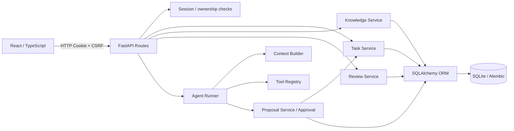

# Personal OS 项目证据包

> 状态：v0.4.0 源码候选材料，不代表 GitHub Release、正式服务升级或生产服务等级。负责人主导产品目标、范围和验收；实现过程使用 AI Coding 辅助。本文不声称所有代码均由负责人独立手写。

## A. 业务问题与目标用户

个人任务、知识来源和 AI 建议分散在不同工具时，用户很难确认一条建议来自哪里、是否经过本人批准、最终是否成为真实任务。Personal OS 面向希望在本机或 Tailnet 内管理个人任务、知识、对话与复盘的个人用户，尝试将 AI 建议置于可追溯、需授权的业务闭环中。

长期愿景是个人认知、决策与行动系统；世界模型、贝叶斯决策、效用评估和反馈校准仍是设计规划，不是当前功能。

## B. 架构与模块职责

- **Task Service**：正式 Task 创建/更新、用户归属、状态历史和幂等入口。
- **Knowledge Service**：用户范围内的知识读取、检索、来源和关联。
- **Review Service**：复盘输入、快照与周汇总，通过 Task Summary 边界读取任务摘要。
- **Agent Runner / Context Builder / Tool Registry**：组织模型请求、限制上下文并执行受控工具。
- **Proposal Service**：保存待审批草案；只有明确批准后才调用 Task Service 写入正式任务。
- **SQLAlchemy / SQLite / Alembic**：ORM 映射、业务数据持久化和显式 schema 迁移。Web 启动时的 Schema Guard 只读检查 revision，不执行迁移。

## C. 关键工程工作

- 将 Review 对 Task ORM 的读取改为公开的最小任务摘要契约，减少跨模块实现耦合。
- 为 Review 页面处理旧异步响应覆盖新输入的竞态，并增加桌面/窄屏保存与读回检查。
- 统一手动任务和审批任务的 Task Service 写入边界，保持 Proposal 草案状态与 Task 正式状态分离。
- 增加邀请摘要存储、单次领取、并发保护和本机 CLI；注册 API 在事务内创建用户、消费邀请和建立 Session。
- 普通 Web 用户不能操作实例级备份/整库导出；用户触发的模型请求要求用户自己的有效 Provider 凭证，进程级共享 Key 不作为 Web 用户回退凭证。
- 增加 production Schema Startup Guard，在启动后台服务前拒绝未知或不匹配的 Alembic revision。
- 将 pytest 的 Trusted Host 配置显式设为 TestClient 的 `testserver` 与本机测试主机，避免干净安装环境从 `.env.example` 继承生产 Trusted Hosts 后出现整批 400。

这些结果描述当前开发工作区的实现，不表示已公开或已在正式服务升级。

## D. 可核验证据

| 检查 | 最近记录结果 | 证据范围 |
|---|---:|---|
| 后端 pytest | 195 passed | R4a-1 白名单 TEMP 副本，合成/隔离测试数据库；23 warnings |
| 前端 Vitest | 39 passed | R4a-1 白名单 TEMP 副本，9 个测试文件 |
| TypeScript + Vite | 退出码 0 | R4a-1 TEMP 副本 `pnpm run build` 执行 `tsc -b` 与 Vite build |
| Playwright | 5 passed | 临时 SQLite、合成账户和 Mock Provider；覆盖注册、任务持久化、Task 隔离、Review、Proposal 等场景 |
| Schema Guard | 10 passed | 临时合成数据库的启动拒绝/成功场景 |
| Vite 构建 | 退出码 0 | 独立临时输出目录；存在大于 500 kB 的 JS chunk 提示 |

后端、前端和构建结果由 R4a-1 本轮 TEMP 白名单副本实际执行；Playwright 5 passed、Schema Guard 10 passed 为此前 R3 回合的实测记录，本轮没有重跑 Playwright。负责人报告手机已测完整核心流程；本档案没有独立手机截图或设备网络证据。没有真实 Provider 质量、公网部署或高并发实测结论。

## E. 故障复盘

### 旧 Schema 仍允许应用进入服务状态

- **问题/根因：** 旧数据库迁移失败后，启动路径仍可能继续，健康接口因而返回成功语义。
- **方案与入口：** production Lifespan 在后台调度器启动前只读比较数据库 revision 与代码 head；见 `backend/app/schema_startup.py`、`backend/app/main.py`。
- **验证：** `backend/tests/test_schema_startup_guard.py`，最近记录 10 passed；包含旧/未知 revision 拒绝场景。
- **边界：** revision 匹配不是所有业务表字段都健康的证明。

### 用户调用错误地回退到进程级共享 Provider Key

- **问题/根因：** 用户凭证缺失或不可用时，原有配置选择路径可能使用实例环境凭证，产生跨用户授权和共享成本问题。
- **方案与入口：** Web 用户调用基于可信 user_id 选择其启用的凭证；见 `backend/app/services/provider_service.py`、`backend/app/services/agent_runner.py`。
- **验证：** `backend/tests/test_provider_key_authorization.py` 等 Provider/Agent 测试；R3 最近后端全量记录 195 passed。
- **边界：** 未建立实例级共享计费/配额方案；无用户凭证时 AI 功能应明确不可用。

### 远程测试初始化门禁与 Review 窄屏布局

- **问题/根因：** 临时测试数据库没有首账户初始化，注册前置状态不满足；390px Review 面板的刷新按钮宽度不足，造成按钮文案竖向折行。
- **方案与入口：** 仅对隔离数据库调用现有初始化 CLI；为 Review 表单补响应式布局；见 `backend/scripts/initialize_admin.py`、`frontend/src/styles.css`。
- **验证：** 最终 Playwright 5 passed；Review 场景检查 390px/1280px 布局、输入、保存和刷新读回。
- **边界：** 真手机流程由负责人报告完成；Playwright 视口不是手机验收替代品。

## F. 三分钟演示路径

使用合成数据库、合成邀请码和 Mock Provider；不要演示真实用户或密钥。

1. **0:00–0:30**：本机 CLI 初始化合成账户并发放邀请码；说明普通 Web 用户没有邀请码管理权。
2. **0:30–1:00**：邀请注册、登录并打开任务工作区。
3. **1:00–1:30**：创建任务、刷新读回；说明正式任务写入集中于 Task Service。
4. **1:30–2:15**：在 Mock Provider 下从 Chat 创建 Proposal，编辑后批准；展示 Proposal 与 Task 的状态差异和关联。
5. **2:15–2:40**：查看 Review 并保存；演示窄屏布局和异步加载保护。
6. **2:40–3:00**：打开测试/发布检查清单，明确展示 ACL、许可证、安装和部署仍是待完成边界。

## G. 面试中主动说明的边界

- v0.3.3 保留为上一条历史发布记录；v0.4.0 已形成源码发布候选，但尚无 GitHub Release、Tag 或正式服务升级。
- 测试证明的是运行过的合成环境场景，不能推出公开云部署、真实模型质量、生产高并发或 Windows ACL 已验收。
- 正式数据目录 ACL 修复、正式服务升级、干净机器安装、候选版本备份恢复和许可证仍需完成。
- R0 决策能力只有设计，不应描述为已实现。
- 负责人定义需求、产品边界和验收标准；AI Coding 辅助实现。不得声称未经证据支持的个人编码占比或生产结果。

## H. 真实代码入口

- 前端入口：`frontend/src/main.tsx`、`frontend/src/TasksWorkspace.tsx`、`frontend/src/ChatWorkspace.tsx`、`frontend/src/DailyReviewWorkspace.tsx`。
- HTTP 与路由：`backend/app/api/routes.py`、`backend/app/api/knowledge_routes.py`。
- 身份与配置：`backend/app/api/deps.py`、`backend/app/auth/security.py`、`backend/app/config.py`。
- 业务服务：`backend/app/services/task_manager.py`、`knowledge_service.py`、`review_service.py`、`agent_runner.py`、`proposal_service.py`、`provider_service.py`、`tool_registry.py`。
- ORM、迁移与启动：`backend/app/models/entities.py`、`backend/alembic/versions/`、`backend/app/schema_startup.py`。
- 验证：`backend/tests/`、`frontend/src/*.test.tsx`、`frontend/e2e/`。
